# MONUSCO withdrawal descriptive evidence packet

12 November 2026. Recorded one-sided civilian deaths are the primary outcome; recorded events are secondary.

**The existing data support timelines and measurement checks, but not a credible estimate of the effect of withdrawal.** The patterns vary by locality, some depend on a single event, and one influential event has conflicting territorial assignments. None of these results establishes that MONUSCO withdrawal increased or decreased underlying civilian deaths.

## What was completed

27 distinct territorial/date displays cover 10 provisional decision clusters. They are not independent experiments. Identical dates and territories within a cluster are deduplicated; overlapping component and provincial displays remain clearly labelled.

- Fixed 24-month baseline and six-month follow-up timelines for every registered, geographically assigned episode with a usable date interval.
- Largest-event review, complete single-event-deletion ranges and source/geography flags.
- Baseline-only profiles for all 19 candidate localities, with event-frequency actor overlap and existing documentary comparison decisions.
- Strict versus conservative territorial inclusion, earliest/latest timing, uniform geography-conflict exclusion, and hypothetical missing-death scenarios.

## How to read the comparisons

The main baseline is the 24 complete calendar months before the earliest documented transition month. Follow-up is the six complete months after the latest documented transition month. All transition months are displayed but omitted from the before/after summaries. Three-month follow-up blocks are also saved. These calendar-month windows differ intentionally from the earlier 90/180-day handover windows; those counts are checked separately.

Because the periods differ in length, comparisons use deaths per month. The descriptive difference is post deaths / 6 minus pre deaths / 24. It is not a treatment effect. The six-month historical benchmark is pre deaths / 4, not an estimate of what would have happened without withdrawal. Seasonality, changing conflict conditions and reporting can all affect it.

Zeros mean no eligible events were retained in the dataset. They do not certify monitoring coverage. GED low/high bound total event deaths; they are not civilian-specific confidence intervals. All outcomes remain the original corrected coding; conflict exclusions are labelled sensitivities.

## South Kivu provincial picture

One provincial decision, eight non-overlapping territorial outcome units. Anchor: protection-operation cessation on 30 April 2024; baseline April 2022 to March 2024 and follow-up May to October 2024.

| definition | deaths_pre | deaths_post | pre_monthly_deaths | post_monthly_deaths | additional_post_deaths_to_erase_decline |
| --- | --- | --- | --- | --- | --- |
| strict | 71 | 8 | 2.958 | 1.333 | 10 |
| territorial | 73 | 11 | 3.042 | 1.833 | 8 |

The last column asks how many additional post-period deaths would reach or exceed the historical monthly benchmark while holding baseline reporting fixed. It does not estimate missing deaths or their plausibility. The strict benchmark is 17.75 deaths in six months; eight are recorded, so ten additional deaths would erase the decline against that benchmark.

Reporting is not stable by assumption: KST announced a pause in November 2023, before the handovers; the UN series stopped covering South Kivu after April 2024; humanitarian reports continued with limited coverage. Source presence does not establish detection completeness. See the [coverage follow-up](withdrawal_protection_coverage_followup.md).

## Priority case findings

| sites | locality | deaths_pre | deaths_post | pre_monthly_deaths | post_monthly_deaths |
| --- | --- | --- | --- | --- | --- |
| Bunyakiri | Kalehe | 7 | 6 | 0.292 | 1.000 |
| Bunyampuri / Walikale centre | Walikale | 43 | 5 | 1.792 | 0.833 |
| Kavumu airport | Kabare including Bukavu | 7 | 2 | 0.292 | 0.333 |
| Luofu | Lubero including Butembo | 42 | 7 | 1.750 | 1.167 |
| Masisi centre / Nyabiondo | Masisi | 0 | 2 | 0.000 | 0.333 |
| Sange | Uvira including city | 13 | 0 | 0.542 | 0.000 |

**Walikale:** the apparent decrease is highly dependent on event 234588, the Luhanga massacre with 34 stored civilian deaths. Its coordinates fall in the project’s Walikale polygon, but GED ADM2 identifies Lubero. [AFP/VOA](https://www.voaafrique.com/a/pres-de-34-civils-tues-dans-aatque-village-hutu-par-des-miliciens-nande-en-rdc/3613252.html) and [Radio Okapi](https://www.radiookapi.net/2016/11/29/actualite/securite/nord-kivu-inhumation-des-victimes-de-massacre-de-luhanga) also identify Lubero. Radio Okapi’s later burial report gives a different civilian tally from the provisional AFP report. Preserve the data for reproduction, but do not treat either the locality assignment or stored fatality bounds as settled.

**Timing correction (12 November):** July 31 is the supported fixed-base closure anchor. October 19 is a retrospective publication date, not a documented departure alternative. Historical envelope and October-anchor outputs remain for reproduction only. Mobile protection continued in named locations; the end of all coverage is unknown. See [follow-up review](withdrawal_followup_review.md).

**Bunyakiri/Kalehe:** four of the six strict follow-up deaths are in Numbi; the other records are in Buganga and Cifunzi Kalonge. These are territorial outcomes, not demonstrated Bunyakiri protection-area outcomes. The local increase survives deleting the four-death event, but the geographic exposure problem remains.

**Kavumu/Kabare:** the strict follow-up contains one recorded death at Katana and one in Bukavu. The Katana record has total-event bounds of 1 to 7. The near-flat monthly comparison does not show that airport handover preserved community protection.

**Sange/Uvira:** the follow-up has no retained strict events, while six of the 13 baseline deaths occurred at Bijombo. An empty follow-up cannot distinguish no eligible violence from incomplete observation; Bijombo’s connection to Sange’s protection area is unresolved.

## Comparison locations

Candidate profiles use only the 24 pre-transition months. No post-withdrawal outcome was used to select or rank controls. Actor overlap is the sum of the smaller event shares for each actor across two baseline distributions; it is undefined when either locality has no recorded baseline events. It is descriptive, not a matching score or causal eligibility threshold.

| episode_group | comparison_location | decision |
| --- | --- | --- |
| 2017 North Kivu closures | Sake | Not an untreated territorial control |
| 2017 Ituri plans | Komanda Aveba Bunia | Need subterritorial geography and actual closure dates |
| Mutarule 2018 | Sange | Not an independent comparison in current panel |
| Mutarule 2018 | Kamanyola | Regional context only |
| Mutwanga and Kamango 2023 | Kilya | Subterritorial redesign needed |
| South Kivu 2024 | Djugu | Not accepted as causal control |
| South Kivu 2024 | Masisi | Exclude as clean retained-presence comparator |
| South Kivu 2024 | Beni | Context only pending stronger evidence |
| South Kivu 2024 | Other South Kivu territories | Cannot serve as untreated controls |
| All other registered episodes | Other 19-locality panel locations | No control approved from pretrend similarity alone |

Sake shares the Masisi outcome unit and supplied activity into Nyabiondo; it cannot be an independent untreated territorial control. Other South Kivu localities share the provincial withdrawal. Djugu and Beni differ in conflict dynamics; Masisi experienced the M23 offensive and a position withdrawal. Similar baseline averages would not override those substantive problems.

Detailed [baseline profiles](../outputs/withdrawal_descriptive/baseline_comparison_profiles.csv) retain all candidates, exposure-listing limitations and other registered changes. No candidate is upgraded to a causal control.

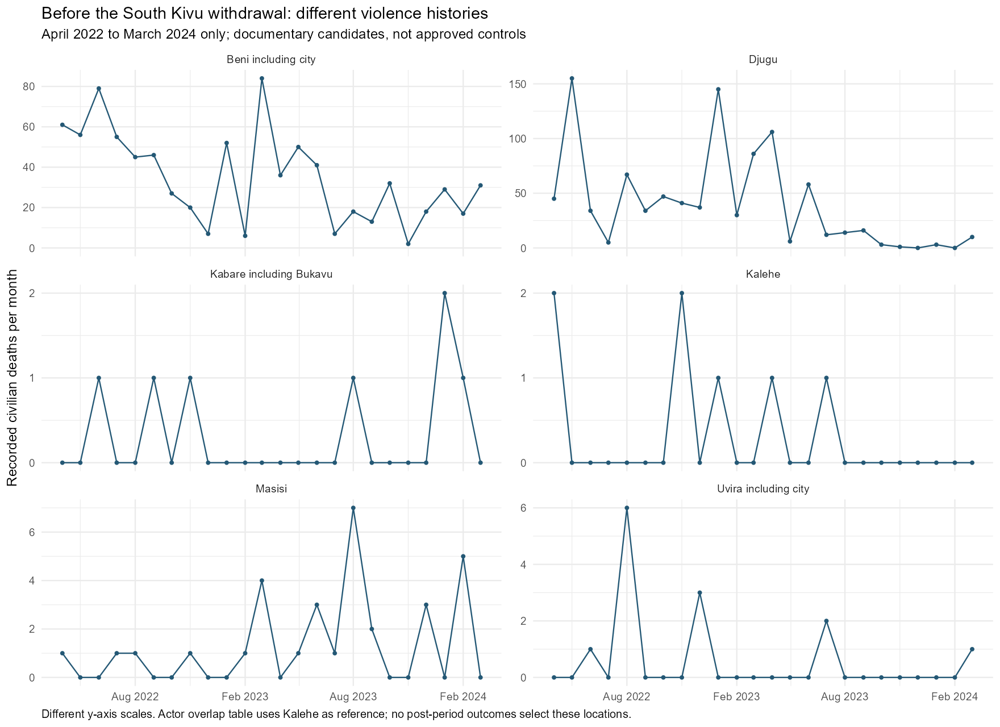

Selected baseline profiles below use Kalehe as the actor-overlap reference. The first/last columns each span 12 months; differences are descriptive. Beni, Djugu and Masisi were already named in the documentary assessment, not selected using these values.

| candidate_locality | deaths | first_12_deaths | last_12_deaths | death_months | actor_overlap | other_change_ids |
| --- | --- | --- | --- | --- | --- | --- |
| Masisi | 31 | 9 | 22 | 13 | 0.388 | sake_2024 |
| Kalehe | 7 | 5 | 2 | 5 | 1.000 | bunyakiri_2024 |
| Djugu | 955 | 726 | 229 | 22 | 0.016 | unknown / not applicable |
| Beni including city | 832 | 538 | 294 | 24 | 0.083 | mutwanga_2023;kamango_2023 |
| Kabare including Bukavu | 7 | 3 | 4 | 6 | 0.875 | kavumu_2024;bukavu_2024 |
| Uvira including city | 13 | 10 | 3 | 5 | 0.750 | sange_2024 |

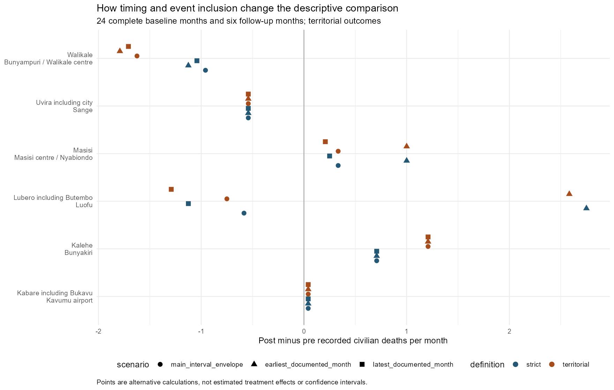

## Checks and human review

The script reconciles every case-month against event-level counts, verifies complete windows and checks upstream input hashes. Original quarter and handover counts are independently rechecked by the validation script. See [validation results](../outputs/withdrawal_descriptive/validation_checks.csv).

Review priority: resolve Luhanga’s coordinates versus the boundary and administrative description before any new primary geographic coding. A uniform sensitivity removes all known ADM2/polygon disagreements, not just this consequential event. Nineteen unique conflicting records occur across the displayed windows; unknown administrative fields are not treated as matches. Other recorded uncertainties are retained in the event ledger.

Patrol catchments, actual patrol continuity and historical monitoring effort still await external records. If those records are unavailable, retain descriptive inference. A causal analysis would require a separate fixed specification and credible comparison, not another fitted model.

## Case pages

Every page below uses the same rules. Images and the [combined timeline PDF](../outputs/withdrawal_descriptive/all_case_timelines.pdf) are generated by R. The tables describe overlapping windows; do not sum across cases.

### Mutwanga - Beni including city

Decision cluster: beni_2023 | Recorded transition: 2023-02-16 to 2023-02-17 | Feasibility class: 2

Descriptive only: Recent calm / joint assessment; security-dependent selection | Territorial outcomes do not establish base protection catchment or a credible counterfactual.

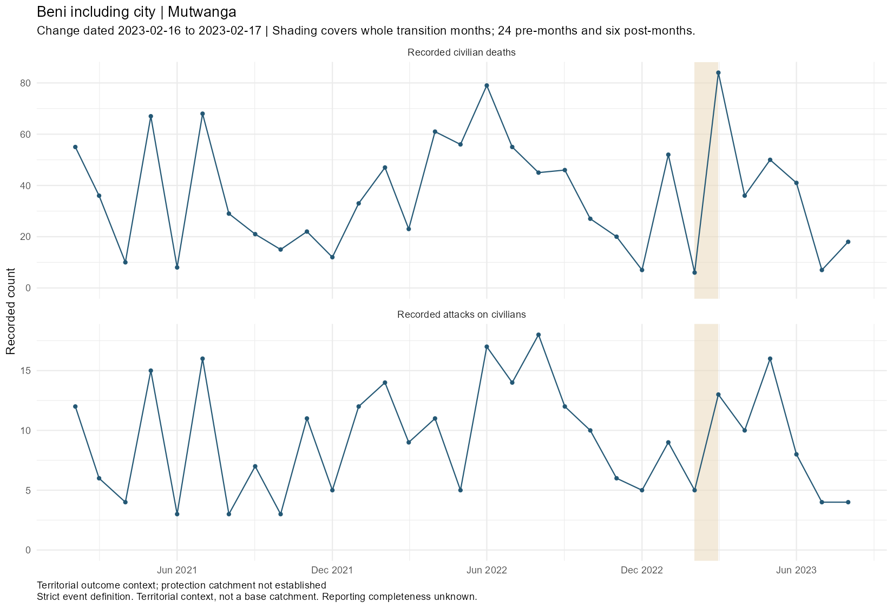

| definition | deaths_pre | deaths_post | events_pre | events_post | monthly_difference |
| --- | --- | --- | --- | --- | --- |
| strict | 894 | 236 | 227 | 55 | 2.083 |
| territorial | 1136 | 286 | 254 | 65 | 0.333 |

**Timing and inclusion sensitivity**

| definition | scenario | deaths_pre | deaths_post | monthly_difference |
| --- | --- | --- | --- | --- |
| strict | earliest_documented_month | 894 | 236 | 2.083 |
| strict | latest_documented_month | 894 | 236 | 2.083 |
| territorial | earliest_documented_month | 1136 | 286 | 0.333 |
| territorial | latest_documented_month | 1136 | 286 | 0.333 |
| strict | main_interval_envelope | 894 | 236 | 2.083 |
| territorial | main_interval_envelope | 1136 | 286 | 0.333 |

Largest pre/post event: 438730 ; deaths: 37 . Monthly difference after deleting that one event: 3.625 . All single-event-deletion differences range from -0.75 to 3.625 (sensitivity range, not an interval estimate).

Removing all known geography conflicts gives 892 pre deaths and 233 post deaths; monthly difference 1.667 . Unknown ADM2 remains unresolved.

**Largest saved event records in each non-transition block**

| block | id | start_date | deaths_civilians | where_description | admin_agrees |
| --- | --- | --- | --- | --- | --- |
| post_1_3 | 468226 | 2023-03-12 | 17 | Kilindera in Beni territory | TRUE |
| post_1_3 | 476012 | 2023-05-19 | 16 | village of Katula in Beni territory,   town of Kavasewa in Beni territory | TRUE |
| post_1_3 | 470024 | 2023-03-14 | 15 | Mandiba in Beni territory | TRUE |
| post_4_6 | 477060 | 2023-06-01 | 13 | village of Kanyamutsutsa in Beni territory | TRUE |
| post_4_6 | 477233 | 2023-06-08 | 12 | village of Bukokoma in Beni territory | TRUE |
| post_4_6 | 478576 | 2023-06-11 | 9 | Kasindi in Beni territory | TRUE |
| pre_24 | 438730 | 2022-05-27 | 37 | Beu Manyama | TRUE |
| pre_24 | 434150 | 2022-04-03 | 36 | Masambo village Basongora cluster, Ruwenzori sector, Beni territory, Nord Kivu province | TRUE |
| pre_24 | 462611 | 2023-01-22 | 24 | Makungwe in Beni territory | TRUE |

[s16: MONUSCO](https://monusco.unmissions.org/fr/news/beni-la-monusco-ferme-sa-base-militaire-de-mutwanga)

### Kamango - Beni including city

Decision cluster: beni_2023 | Recorded transition: 2023-04-06 to 2023-04-06 | Feasibility class: 2

Descriptive only: Improving security / transition; FARDC also present | Territorial outcomes do not establish base protection catchment or a credible counterfactual.

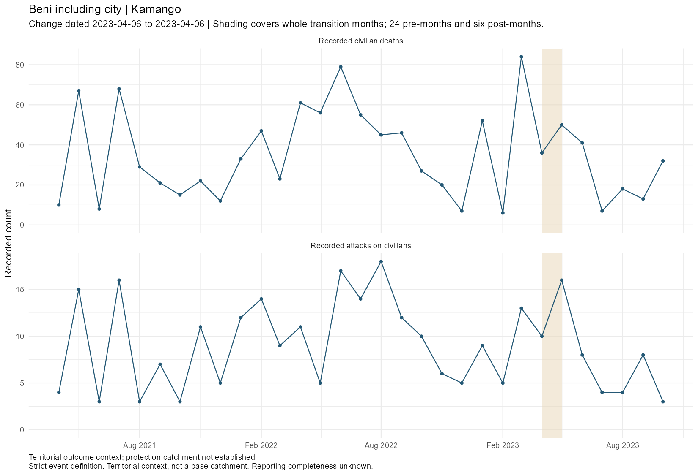

| definition | deaths_pre | deaths_post | events_pre | events_post | monthly_difference |
| --- | --- | --- | --- | --- | --- |
| strict | 893 | 161 | 227 | 43 | -10.375 |
| territorial | 1110 | 194 | 255 | 51 | -13.917 |

**Timing and inclusion sensitivity**

| definition | scenario | deaths_pre | deaths_post | monthly_difference |
| --- | --- | --- | --- | --- |
| strict | earliest_documented_month | 893 | 161 | -10.375 |
| strict | latest_documented_month | 893 | 161 | -10.375 |
| territorial | earliest_documented_month | 1110 | 194 | -13.917 |
| territorial | latest_documented_month | 1110 | 194 | -13.917 |
| strict | main_interval_envelope | 893 | 161 | -10.375 |
| territorial | main_interval_envelope | 1110 | 194 | -13.917 |

Largest pre/post event: 438730 ; deaths: 37 . Monthly difference after deleting that one event: -8.833 . All single-event-deletion differences range from -14.875 to -8.833 (sensitivity range, not an interval estimate).

Removing all known geography conflicts gives 891 pre deaths and 161 post deaths; monthly difference -10.292 . Unknown ADM2 remains unresolved.

**Largest saved event records in each non-transition block**

| block | id | start_date | deaths_civilians | where_description | admin_agrees |
| --- | --- | --- | --- | --- | --- |
| post_1_3 | 476012 | 2023-05-19 | 16 | village of Katula in Beni territory,   town of Kavasewa in Beni territory | TRUE |
| post_1_3 | 477060 | 2023-06-01 | 13 | village of Kanyamutsutsa in Beni territory | TRUE |
| post_1_3 | 477233 | 2023-06-08 | 12 | village of Bukokoma in Beni territory | TRUE |
| post_4_6 | 496934 | 2023-10-23 | 27 | Pas Mal and Kafeza, two cells in the Masosi district in the commune of Oicha, in Oicha, capital of the Beni territory in North Kivu | TRUE |
| post_4_6 | 490401 | 2023-08-24 | 7 | Mangugu village, Manvuwa village, Bandenge village, Nzakiya village, Ilac village  sector of Beni-Mbau, Batangi Mbau group, locality of Babila Bakaiko  / in the chiefdom of Walese Vunkutu and the locality of Babila Bakaiko of Mamove | TRUE |
| post_4_6 | 487505 | 2023-08-13 | 6 | in the villages of Mbingi and Moliso in Beni territory | TRUE |
| pre_24 | 438730 | 2022-05-27 | 37 | Beu Manyama | TRUE |
| pre_24 | 434150 | 2022-04-03 | 36 | Masambo village Basongora cluster, Ruwenzori sector, Beni territory, Nord Kivu province | TRUE |
| pre_24 | 462611 | 2023-01-22 | 24 | Makungwe in Beni territory | TRUE |

[s17: UN](https://peacekeeping.un.org/fr/news/nord-kivu-la-monusco-ferme-une-nouvelle-base-militaire-dans-le-territoire-de-beni)

### Butembo - Lubero including Butembo

Decision cluster: butembo_2022 | Recorded transition: 2022-08-18 to 2022-08-24 | Feasibility class: 2

Descriptive only: Violent anti-UN protests prompted departure | Territorial outcomes do not establish base protection catchment or a credible counterfactual.

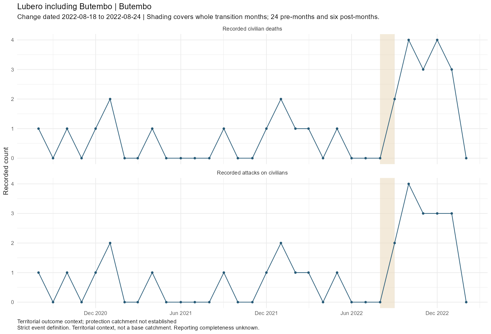

| definition | deaths_pre | deaths_post | events_pre | events_post | monthly_difference |
| --- | --- | --- | --- | --- | --- |
| strict | 13 | 16 | 13 | 15 | 2.125 |
| territorial | 14 | 16 | 14 | 15 | 2.083 |

**Timing and inclusion sensitivity**

| definition | scenario | deaths_pre | deaths_post | monthly_difference |
| --- | --- | --- | --- | --- |
| strict | earliest_documented_month | 13 | 16 | 2.125 |
| strict | latest_documented_month | 13 | 16 | 2.125 |
| territorial | earliest_documented_month | 14 | 16 | 2.083 |
| territorial | latest_documented_month | 14 | 16 | 2.083 |
| strict | main_interval_envelope | 13 | 16 | 2.125 |
| territorial | main_interval_envelope | 14 | 16 | 2.083 |

Largest pre/post event: 460043 ; deaths: 2 . Monthly difference after deleting that one event: 1.792 . All single-event-deletion differences range from 1.792 to 2.167 (sensitivity range, not an interval estimate).

Removing all known geography conflicts gives 13 pre deaths and 16 post deaths; monthly difference 2.125 . Unknown ADM2 remains unresolved.

**Largest saved event records in each non-transition block**

| block | id | start_date | deaths_civilians | where_description | admin_agrees |
| --- | --- | --- | --- | --- | --- |
| post_1_3 | 447896 | 2022-09-11 | 1 | Wayene district of Butembo. | TRUE |
| post_1_3 | 449697 | 2022-09-16 | 1 | Musienene, Nord-Kivu | TRUE |
| post_1_3 | 451308 | 2022-10-05 | 1 | Mukalangirwa district of Butembo | TRUE |
| post_4_6 | 460043 | 2022-12-02 | 2 | Butembo | TRUE |
| post_4_6 | 460093 | 2022-12-14 | 1 | Congo ya Sika district of Butembo | TRUE |
| post_4_6 | 460136 | 2022-12-28 | 1 | Butembo, Nord-Kivu | TRUE |
| pre_24 | 349153 | 2020-08-06 | 1 | Kasiki village in Lubero territory | TRUE |
| pre_24 | 364724 | 2020-10-16 | 1 | Hutwe village in Lubero territory. | TRUE |
| pre_24 | 375166 | 2020-12-29 | 1 | Kamandi locality in Lubero territory | TRUE |

[s11: ACP](https://acp.cd/nation/nord-kivu-le-gouverneur-annonce-la-fermeture-de-la-base-de-la-monusco-et-le-retrait-definitif-de-son-personnel-a-butembo/) ; [s12: VOA AFP](https://www.voaafrique.com/a/la-force-de-mission-onusienne-quitte-la-ville-de-butembo-dans-l-est-de-la-rdc/6708239.html)

### Lubero - Lubero including Butembo

Decision cluster: lubero_2023 | Recorded transition: 2023-12-26 to 2023-12-26 | Feasibility class: 2

Descriptive only: Joint assessment; prior Butembo departure and later M23 expansion | Territorial outcomes do not establish base protection catchment or a credible counterfactual.

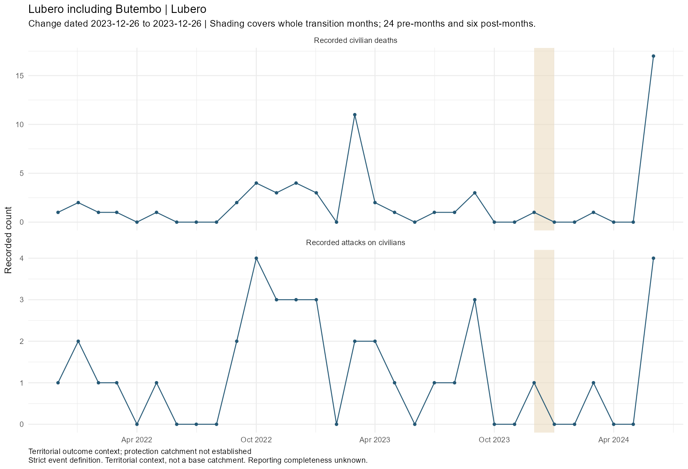

| definition | deaths_pre | deaths_post | events_pre | events_post | monthly_difference |
| --- | --- | --- | --- | --- | --- |
| strict | 41 | 18 | 31 | 5 | 1.292 |
| territorial | 41 | 22 | 31 | 9 | 1.958 |

**Timing and inclusion sensitivity**

| definition | scenario | deaths_pre | deaths_post | monthly_difference |
| --- | --- | --- | --- | --- |
| strict | earliest_documented_month | 41 | 18 | 1.292 |
| strict | latest_documented_month | 41 | 18 | 1.292 |
| territorial | earliest_documented_month | 41 | 22 | 1.958 |
| territorial | latest_documented_month | 41 | 22 | 1.958 |
| strict | main_interval_envelope | 41 | 18 | 1.292 |
| territorial | main_interval_envelope | 41 | 22 | 1.958 |

Largest pre/post event: 530000 ; deaths: 14 . Monthly difference after deleting that one event: -1.042 . All single-event-deletion differences range from -1.042 to 1.708 (sensitivity range, not an interval estimate).

Removing all known geography conflicts gives 41 pre deaths and 18 post deaths; monthly difference 1.292 . Unknown ADM2 remains unresolved.

**Largest saved event records in each non-transition block**

| block | id | start_date | deaths_civilians | where_description | admin_agrees |
| --- | --- | --- | --- | --- | --- |
| post_1_3 | 563500 | 2024-03-21 | 1 | Rughenda, Bulengera commune, a commercial city of Butembo | TRUE |
| post_4_6 | 530000 | 2024-06-21 | 14 | Kyanganda village,  in the Manzia group, in the Bapere sector of Lubero territory, located in North Kivu province | TRUE |
| post_4_6 | 565475 | 2024-06-12 | 3 | Kambau, a town located in the Lubero territory, in North Kivu in North Kivu. | TRUE |
| post_4_6 | 560981 | 2024-06-24 | 0 | Njiapanda in the Lubero area | TRUE |
| pre_24 | 470093 | 2023-03-18 | 10 | Nguli in Lubero territory | TRUE |
| pre_24 | 460043 | 2022-12-02 | 2 | Butembo | TRUE |
| pre_24 | 425202 | 2021-12-25 | 1 | Ntoyo, Nord-Kivu | TRUE |

[s18: MONUSCO](https://monusco.unmissions.org/en/node/11624)

### Lusenda - Fizi including Baraka

Decision cluster: lusenda_2021 | Recorded transition: 2021-01-07 to 2021-01-07 | Feasibility class: 2

Descriptive only: Closure documented; selection reason needs further evidence | Territorial outcomes do not establish base protection catchment or a credible counterfactual.

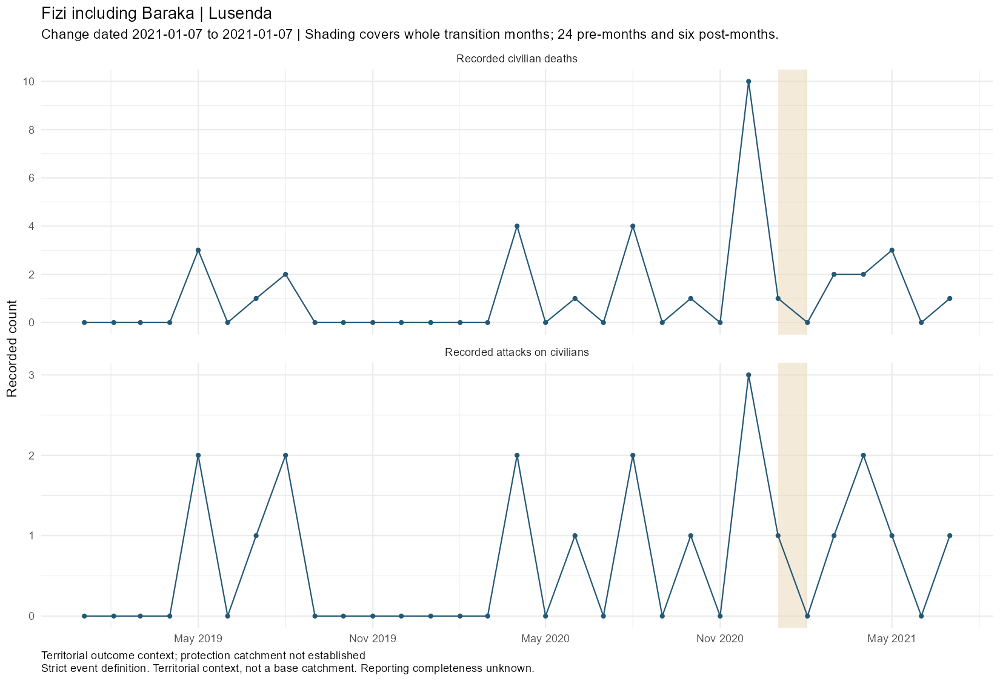

| definition | deaths_pre | deaths_post | events_pre | events_post | monthly_difference |
| --- | --- | --- | --- | --- | --- |
| strict | 26 | 8 | 14 | 5 | 0.25 |
| territorial | 26 | 8 | 14 | 5 | 0.25 |

**Timing and inclusion sensitivity**

| definition | scenario | deaths_pre | deaths_post | monthly_difference |
| --- | --- | --- | --- | --- |
| strict | earliest_documented_month | 26 | 8 | 0.25 |
| strict | latest_documented_month | 26 | 8 | 0.25 |
| territorial | earliest_documented_month | 26 | 8 | 0.25 |
| territorial | latest_documented_month | 26 | 8 | 0.25 |
| strict | main_interval_envelope | 26 | 8 | 0.25 |
| territorial | main_interval_envelope | 26 | 8 | 0.25 |

Largest pre/post event: 375169 ; deaths: 6 . Monthly difference after deleting that one event: 0.5 . All single-event-deletion differences range from -0.25 to 0.5 (sensitivity range, not an interval estimate).

Removing all known geography conflicts gives 17 pre deaths and 8 post deaths; monthly difference 0.625 . Unknown ADM2 remains unresolved.

**Largest saved event records in each non-transition block**

| block | id | start_date | deaths_civilians | where_description | admin_agrees |
| --- | --- | --- | --- | --- | --- |
| post_1_3 | 390249 | 2021-03-10 | 2 | Lusenda village in Fizi territory | TRUE |
| post_1_3 | 395071 | 2021-04-19 | 1 | Nyange village in Fizi territory | TRUE |
| post_1_3 | 395586 | 2021-04-21 | 1 | Malera, in the middle plateaus of Bibokoboko, in the territory of Fizi | TRUE |
| post_4_6 | 398025 | 2021-05-05 | 3 | Kabara village in Fizi territory | TRUE |
| post_4_6 | 410789 | 2021-07-17 | 1 | Muchombe village in Fizi territory | TRUE |
| pre_24 | 375169 | 2020-12-30 | 6 | Kibindibindi village | FALSE |
| pre_24 | 339132 | 2020-04-18 | 3 | Kivumu in Musika. | TRUE |
| pre_24 | 352941 | 2020-08-07 | 3 | Mitamba village in Uvira | FALSE |

[s08: Radio Okapi](https://www.radiookapi.net/2021/01/11/actualite/securite/rdc-la-monusco-ferme-sa-base-operationnelle-de-lusenda-fizi)

### Rumangabo - Rutshuru

Decision cluster: m23_2022 | Recorded transition: 2022-11-01 to 2022-11-01 | Feasibility class: 2

Descriptive only: M23 offensive and supply disruption directly confound withdrawal | Territorial outcomes do not establish base protection catchment or a credible counterfactual.

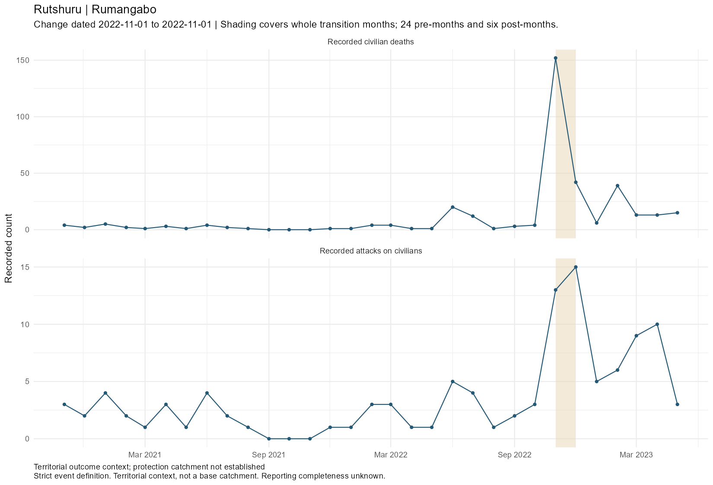

| definition | deaths_pre | deaths_post | events_pre | events_post | monthly_difference |
| --- | --- | --- | --- | --- | --- |
| strict | 77 | 128 | 48 | 48 | 18.125 |
| territorial | 90 | 132 | 51 | 50 | 18.250 |

**Timing and inclusion sensitivity**

| definition | scenario | deaths_pre | deaths_post | monthly_difference |
| --- | --- | --- | --- | --- |
| strict | earliest_documented_month | 77 | 128 | 18.125 |
| strict | latest_documented_month | 77 | 128 | 18.125 |
| territorial | earliest_documented_month | 90 | 132 | 18.250 |
| territorial | latest_documented_month | 90 | 132 | 18.250 |
| strict | main_interval_envelope | 77 | 128 | 18.125 |
| territorial | main_interval_envelope | 90 | 132 | 18.250 |

Largest pre/post event: 466333 ; deaths: 32 . Monthly difference after deleting that one event: 12.792 . All single-event-deletion differences range from 12.792 to 18.667 (sensitivity range, not an interval estimate).

Removing all known geography conflicts gives 73 pre deaths and 126 post deaths; monthly difference 17.958 . Unknown ADM2 remains unresolved.

**Largest saved event records in each non-transition block**

| block | id | start_date | deaths_civilians | where_description | admin_agrees |
| --- | --- | --- | --- | --- | --- |
| post_1_3 | 466333 | 2023-02-26 | 32 | Kanyangiri, Nord-Kivu Tongo and the surroundings, in Bwito chieftaincy, Rutshuru Territory [Nord Kivu, eastern DR Congo]. | TRUE |
| post_1_3 | 460626 | 2022-12-14 | 21 | Nduro | TRUE |
| post_1_3 | 471252 | 2022-12-03 | 4 | Biruma in Rutshuru territory. | TRUE |
| post_4_6 | 474970 | 2023-05-03 | 13 | Kizimba  Kisimba, in North Kivu province's Masisi territory,  Kisimba camp, 4km from Kitshanga, in the Rutshuru territory (North Kivu province). | TRUE |
| post_4_6 | 470439 | 2023-03-07 | 5 | Congo | TRUE |
| post_4_6 | 471088 | 2023-03-31 | 2 | Bukombo | TRUE |
| pre_24 | 441887 | 2022-06-21 | 13 | Ruvumu Kisigari groupement | TRUE |
| pre_24 | 444369 | 2022-07-01 | 9 | Ruseke | TRUE |
| pre_24 | 442479 | 2022-06-18 | 4 | Mugwata village in Rutshuru territory. | TRUE |

[s13: Afrique Actu](https://afriquactu.net/2022/11/01/rumangabo-la-monusco-opere-un-retrait-strategique-et-tactique/)

### Mutarule - Uvira including city

Decision cluster: mutarule_2018 | Recorded transition: 2018-10-05 to 2018-10-09 | Feasibility class: 2

Descriptive only: Improved security cited; selection on prior security | Territorial outcomes do not establish base protection catchment or a credible counterfactual.

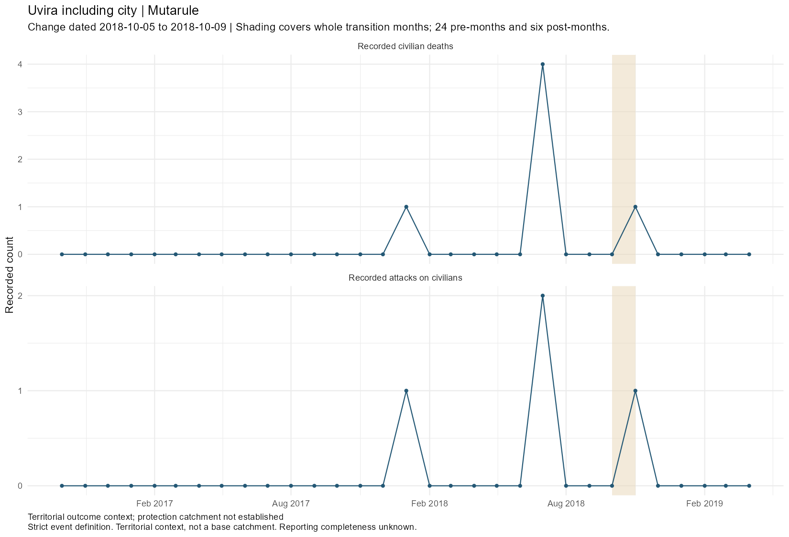

| definition | deaths_pre | deaths_post | events_pre | events_post | monthly_difference |
| --- | --- | --- | --- | --- | --- |
| strict | 5 | 1 | 3 | 1 | -0.042 |
| territorial | 13 | 1 | 6 | 1 | -0.375 |

**Timing and inclusion sensitivity**

| definition | scenario | deaths_pre | deaths_post | monthly_difference |
| --- | --- | --- | --- | --- |
| strict | earliest_documented_month | 5 | 1 | -0.042 |
| strict | latest_documented_month | 5 | 1 | -0.042 |
| territorial | earliest_documented_month | 13 | 1 | -0.375 |
| territorial | latest_documented_month | 13 | 1 | -0.375 |
| strict | main_interval_envelope | 5 | 1 | -0.042 |
| territorial | main_interval_envelope | 13 | 1 | -0.375 |

Largest pre/post event: 260637 ; deaths: 3 . Monthly difference after deleting that one event: 0.083 . All single-event-deletion differences range from -0.208 to 0.083 (sensitivity range, not an interval estimate).

Removing all known geography conflicts gives 5 pre deaths and 1 post deaths; monthly difference -0.042 . Unknown ADM2 remains unresolved.

**Largest saved event records in each non-transition block**

| block | id | start_date | deaths_civilians | where_description | admin_agrees |
| --- | --- | --- | --- | --- | --- |
| post_1_3 | 271931 | 2018-11-13 | 1 | Kimuka village in Uvira territory | TRUE |
| pre_24 | 260637 | 2018-07-05 | 3 | in the Bijombo highlands of Uvira territory in South Kivu province. | TRUE |
| pre_24 | 253446 | 2018-01-13 | 1 | village of Kibungu in Uvira territory | TRUE |
| pre_24 | 275019 | 2018-07-14 | 1 | Rubibi village, Uvira territory | TRUE |

[s06: MONUSCO](https://monusco.unmissions.org/fr/news/sud-kivu-la-population-sinquiete-de-la-fermeture-de-la-base-de-la-monusco-a-mutarule)

### Masisi centre / Nyabiondo - Masisi

Decision cluster: nk_2017_reconfiguration | Recorded transition: 2017-07-31 to 2017-10-19 | Feasibility class: 2

Descriptive only: Budget / force reconfiguration; broad implementation interval not final convoy dates | Territorial outcomes do not establish base protection catchment or a credible counterfactual.

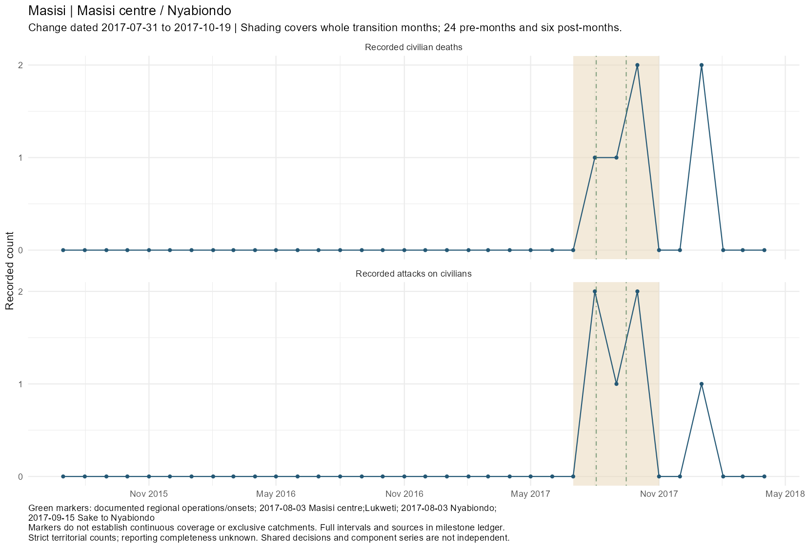

| definition | deaths_pre | deaths_post | events_pre | events_post | monthly_difference |
| --- | --- | --- | --- | --- | --- |
| strict | 0 | 2 | 0 | 1 | 0.333 |
| territorial | 0 | 2 | 0 | 1 | 0.333 |

**Timing and inclusion sensitivity**

| definition | scenario | deaths_pre | deaths_post | monthly_difference |
| --- | --- | --- | --- | --- |
| strict | earliest_documented_month | 0 | 6 | 1.000 |
| strict | latest_documented_month | 2 | 2 | 0.250 |
| territorial | earliest_documented_month | 0 | 6 | 1.000 |
| territorial | latest_documented_month | 3 | 2 | 0.208 |
| strict | main_interval_envelope | 0 | 2 | 0.333 |
| territorial | main_interval_envelope | 0 | 2 | 0.333 |

Largest pre/post event: 253511 ; deaths: 2 . Monthly difference after deleting that one event: 0 . All single-event-deletion differences range from 0 to 0 (sensitivity range, not an interval estimate).

Removing all known geography conflicts gives 0 pre deaths and 2 post deaths; monthly difference 0.333 . Unknown ADM2 remains unresolved.

**Largest saved event records in each non-transition block**

| block | id | start_date | deaths_civilians | where_description | admin_agrees |
| --- | --- | --- | --- | --- | --- |
| post_1_3 | 253511 | 2018-01-19 | 2 | Mpati village in Masisi territory | TRUE |

**Documentary protection milestones**

| date_lower | date_upper | documented_area | activity_type | limitation |
| --- | --- | --- | --- | --- |
| 2017-08-03 | unknown / not applicable | Masisi centre;Lukweti | mobile deployment reported | No patrol radius or complete schedule |
| 2017-08-03 | unknown / not applicable | Nyabiondo | mobile deployment reported | Deployment onset does not equal uninterrupted presence |
| 2017-09-15 | 2017-09-16 | Sake to Nyabiondo | documented mission | Travel route not given; not continuous patrol coverage |
| 2018-02-01 | 2018-02-28 | Nyabiondo | assessment / proposed longer presence | Do not code proposal as presence |

[s03: MONUSCO](https://www.unmissions.org/en/peacekeeping/news/closure-of-5-fixed-bases-in-the-north-kivu-province-for-the-purposes-of-more) ; [s04: CIVIC](https://civiliansinconflict.org/wp-content/uploads/2018/02/Protection-Mandate-French-Translation-Web.pdf) ; [s28: Radio Okapi](https://www.radiookapi.net/2017/10/19/actualite/securite/nord-kivu-evaluation-des-defis-securitaires-apres-la-fermeture-des) ; [p01: MONUSCO](https://monusco.unmissions.org/fr/news/la-monusco-experimente-un-nouveau-dispositif-militaire-au-nord-kivu-apres-la-fermeture) ; [p02: UN weekly briefing](https://monusco.unmissions.org/sites/default/files/compte-rendu_de_lactualite_des_nations_unies_en_rdc_du_16_au_23_aout_2017_final.pdf) ; [p03: UN weekly briefing](https://monusco.unmissions.org/sites/default/files/compte-rendu_de_lactualite_des_nations_unies_en_rdc_du_13_au_20_septembre_final.pdf) ; [p04: UNJHRO](https://monusco.unmissions.org/sites/default/files/bcnudh_rapport_masisi-lubero_19_decembre_2018_-_final_1.pdf) ; [p08: UN weekly briefing](https://monusco.unmissions.org/sites/default/files/compte-rendu_de_lactualite_des_nations_unies_en_rdc_du_9_au_16_aout_2017.pdf)

### Bunyampuri / Walikale centre - Walikale

Decision cluster: nk_2017_reconfiguration | Recorded transition: 2017-07-31 to 2017-10-19 | Feasibility class: 2

Descriptive only: Budget / force reconfiguration; broad implementation interval not final convoy dates | Territorial outcomes do not establish base protection catchment or a credible counterfactual.

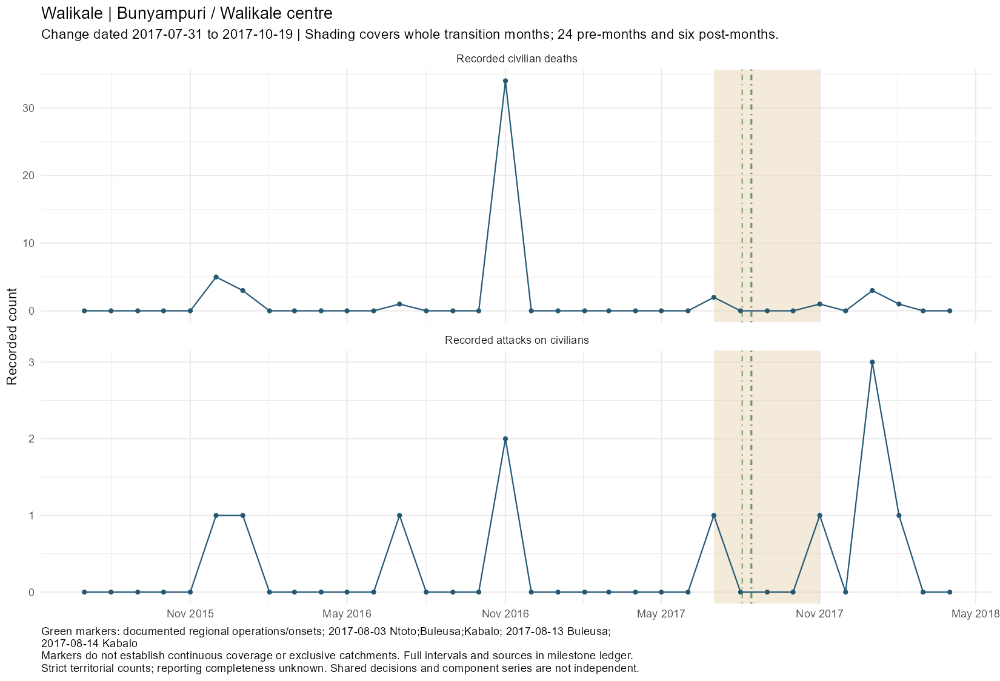

| definition | deaths_pre | deaths_post | events_pre | events_post | monthly_difference |
| --- | --- | --- | --- | --- | --- |
| strict | 43 | 5 | 5 | 5 | -0.958 |
| territorial | 59 | 5 | 8 | 5 | -1.625 |

**Timing and inclusion sensitivity**

| definition | scenario | deaths_pre | deaths_post | monthly_difference |
| --- | --- | --- | --- | --- |
| strict | earliest_documented_month | 43 | 4 | -1.125 |
| strict | latest_documented_month | 45 | 5 | -1.042 |
| territorial | earliest_documented_month | 59 | 4 | -1.792 |
| territorial | latest_documented_month | 61 | 5 | -1.708 |
| strict | main_interval_envelope | 43 | 5 | -0.958 |
| territorial | main_interval_envelope | 59 | 5 | -1.625 |

Largest pre/post event: 234588 ; deaths: 34 . Monthly difference after deleting that one event: 0.458 . All single-event-deletion differences range from -1.125 to 0.458 (sensitivity range, not an interval estimate).

Removing all known geography conflicts gives 9 pre deaths and 5 post deaths; monthly difference 0.458 . Unknown ADM2 remains unresolved.

**Largest saved event records in each non-transition block**

| block | id | start_date | deaths_civilians | where_description | admin_agrees |
| --- | --- | --- | --- | --- | --- |
| post_1_3 | 250154 | 2017-11-28 | 1 | Bireshe in Walikale territory | TRUE |
| post_1_3 | 253538 | 2018-01-25 | 1 | Bukumbirwa in Walikale territory | TRUE |
| post_1_3 | 253543 | 2018-01-15 | 1 | Matenge village in Walikale territory  Matenge (Masisi-Walikale boundary, Mweso axis Matenge dans la localité Nsuka; groupement Kisimba territoire de Walikale | TRUE |
| post_4_6 | 253557 | 2018-02-07 | 1 | Mpeti village in Walikale territory | TRUE |
| pre_24 | 234588 | 2016-11-27 | 34 | Luhanga Luhanga, dans le groupement Itala, chefferie des Batangi | FALSE |
| pre_24 | 207380 | 2015-12-21 | 5 | Beleusa | TRUE |
| pre_24 | 357648 | 2016-01-05 | 3 | Buleusa in the Territory ofWalikale / Gpt Ikobo | TRUE |

**Documentary protection milestones**

| date_lower | date_upper | documented_area | activity_type | limitation |
| --- | --- | --- | --- | --- |
| 2017-08-03 | unknown / not applicable | Ntoto;Buleusa;Kabalo | regional mobile deployments | Buleusa geography conflicts across UN reports |
| 2017-08-13 | 2017-08-19 | Buleusa | temporary base | Reported as Lubero here and Walikale in p01; assignment unresolved |
| 2017-08-14 | 2017-08-18 | Kabalo | temporary base | No proof it covered closed-base surroundings |

[s03: MONUSCO](https://www.unmissions.org/en/peacekeeping/news/closure-of-5-fixed-bases-in-the-north-kivu-province-for-the-purposes-of-more) ; [s04: CIVIC](https://civiliansinconflict.org/wp-content/uploads/2018/02/Protection-Mandate-French-Translation-Web.pdf) ; [s28: Radio Okapi](https://www.radiookapi.net/2017/10/19/actualite/securite/nord-kivu-evaluation-des-defis-securitaires-apres-la-fermeture-des) ; [p01: MONUSCO](https://monusco.unmissions.org/fr/news/la-monusco-experimente-un-nouveau-dispositif-militaire-au-nord-kivu-apres-la-fermeture) ; [p02: UN weekly briefing](https://monusco.unmissions.org/sites/default/files/compte-rendu_de_lactualite_des_nations_unies_en_rdc_du_16_au_23_aout_2017_final.pdf) ; [p08: UN weekly briefing](https://monusco.unmissions.org/sites/default/files/compte-rendu_de_lactualite_des_nations_unies_en_rdc_du_9_au_16_aout_2017.pdf)

### Luofu - Lubero including Butembo

Decision cluster: nk_2017_reconfiguration | Recorded transition: 2017-07-31 to 2017-10-19 | Feasibility class: 2

Descriptive only: Budget / force reconfiguration; broad implementation interval not final convoy dates | Territorial outcomes do not establish base protection catchment or a credible counterfactual.

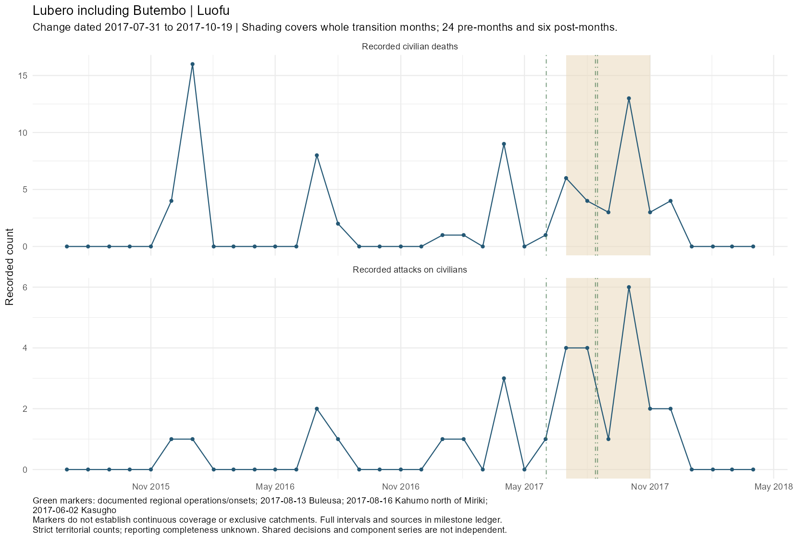

| definition | deaths_pre | deaths_post | events_pre | events_post | monthly_difference |
| --- | --- | --- | --- | --- | --- |
| strict | 42 | 7 | 11 | 4 | -0.583 |
| territorial | 46 | 7 | 13 | 4 | -0.750 |

**Timing and inclusion sensitivity**

| definition | scenario | deaths_pre | deaths_post | monthly_difference |
| --- | --- | --- | --- | --- |
| strict | earliest_documented_month | 42 | 27 | 2.750 |
| strict | latest_documented_month | 55 | 7 | -1.125 |
| territorial | earliest_documented_month | 46 | 27 | 2.583 |
| territorial | latest_documented_month | 59 | 7 | -1.292 |
| strict | main_interval_envelope | 42 | 7 | -0.583 |
| territorial | main_interval_envelope | 46 | 7 | -0.750 |

Largest pre/post event: 207395 ; deaths: 16 . Monthly difference after deleting that one event: 0.083 . All single-event-deletion differences range from -1.083 to 0.083 (sensitivity range, not an interval estimate).

Removing all known geography conflicts gives 42 pre deaths and 7 post deaths; monthly difference -0.583 . Unknown ADM2 remains unresolved.

**Largest saved event records in each non-transition block**

| block | id | start_date | deaths_civilians | where_description | admin_agrees |
| --- | --- | --- | --- | --- | --- |
| post_1_3 | 250334 | 2017-12-19 | 3 | village of Kagheri in Lubero territory. | TRUE |
| post_1_3 | 357576 | 2017-11-15 | 2 | Kanyatsi | TRUE |
| post_1_3 | 250151 | 2017-11-05 | 1 | unknown / not applicable | TRUE |
| pre_24 | 207395 | 2016-01-07 | 16 | Miriki, 110 kilometres (65 miles) north of Goma, capital of conflict-torn North Kivu province. | TRUE |
| pre_24 | 357661 | 2016-07-20 | 5 | unknown / not applicable | TRUE |
| pre_24 | 590823 | 2017-04-11 | 5 | Katanga | TRUE |

**Documentary protection milestones**

| date_lower | date_upper | documented_area | activity_type | limitation |
| --- | --- | --- | --- | --- |
| 2017-08-13 | 2017-08-19 | Buleusa | temporary base | Reported as Lubero here and Walikale in p01; assignment unresolved |
| 2017-08-16 | 2017-08-17 | Kahumo north of Miriki | temporary base | No documented Luofu-origin patrol link |
| unknown / not applicable | unknown / not applicable | Luofu | temporary base caption | Do not date photo using article date |
| 2017-06-02 | 2017-06-05 | Kasugho | pre-closure temporary operation | No continuous regional coverage implied |
| 2019-06-01 | 2019-06-30 | Luofu | later closure documented | Outside initial 2017 follow-up |

[s03: MONUSCO](https://www.unmissions.org/en/peacekeeping/news/closure-of-5-fixed-bases-in-the-north-kivu-province-for-the-purposes-of-more) ; [s04: CIVIC](https://civiliansinconflict.org/wp-content/uploads/2018/02/Protection-Mandate-French-Translation-Web.pdf) ; [s28: Radio Okapi](https://www.radiookapi.net/2017/10/19/actualite/securite/nord-kivu-evaluation-des-defis-securitaires-apres-la-fermeture-des) ; [p01: MONUSCO](https://monusco.unmissions.org/fr/news/la-monusco-experimente-un-nouveau-dispositif-militaire-au-nord-kivu-apres-la-fermeture) ; [p02: UN weekly briefing](https://monusco.unmissions.org/sites/default/files/compte-rendu_de_lactualite_des_nations_unies_en_rdc_du_16_au_23_aout_2017_final.pdf) ; [p05: UNJHRO 2019-June 2021 review](https://monusco.unmissions.org/sites/default/files/bcnudh_rapport_sur_la_protection_des_civils_masisi_et_lubero_janvier_2019_a_juin_2021.pdf) ; [p08: UN weekly briefing](https://monusco.unmissions.org/sites/default/files/compte-rendu_de_lactualite_des_nations_unies_en_rdc_du_9_au_16_aout_2017.pdf)

### Sake blocking positions - Masisi

Decision cluster: nk_m23_2024 | Recorded transition: 2024-04-04 to 2024-04-04 | Feasibility class: 2

Descriptive only: Direct and indirect fire; not a complete Masisi withdrawal | Territorial outcomes do not establish base protection catchment or a credible counterfactual.

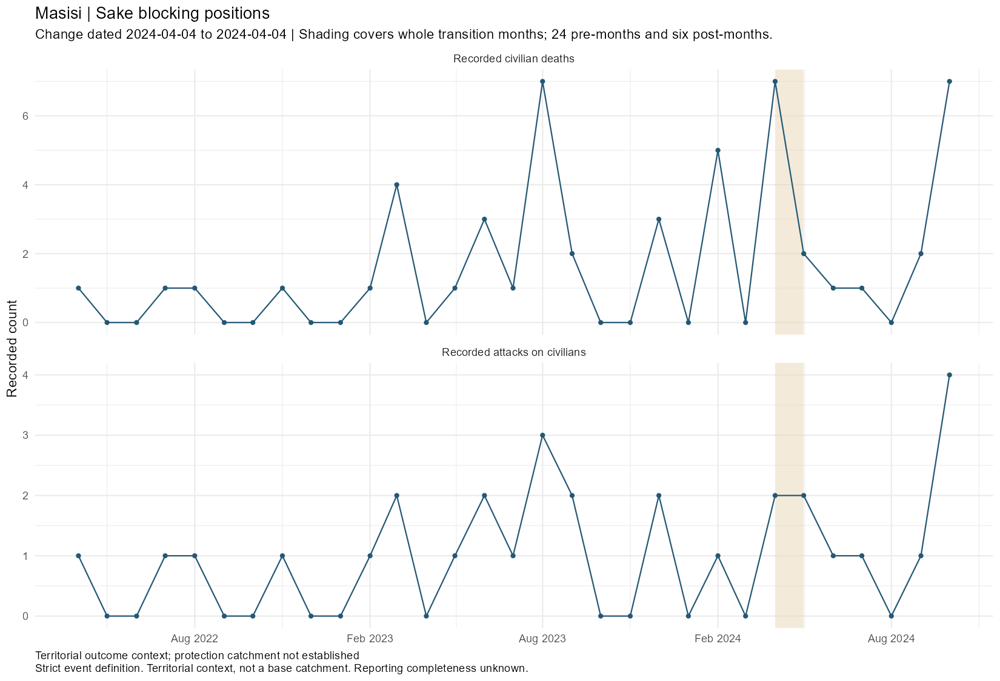

| definition | deaths_pre | deaths_post | events_pre | events_post | monthly_difference |
| --- | --- | --- | --- | --- | --- |
| strict | 31 | 13 | 19 | 9 | 0.875 |
| territorial | 33 | 13 | 21 | 9 | 0.792 |

**Timing and inclusion sensitivity**

| definition | scenario | deaths_pre | deaths_post | monthly_difference |
| --- | --- | --- | --- | --- |
| strict | earliest_documented_month | 31 | 13 | 0.875 |
| strict | latest_documented_month | 31 | 13 | 0.875 |
| territorial | earliest_documented_month | 33 | 13 | 0.792 |
| territorial | latest_documented_month | 33 | 13 | 0.792 |
| strict | main_interval_envelope | 31 | 13 | 0.875 |
| territorial | main_interval_envelope | 33 | 13 | 0.792 |

Largest pre/post event: 532736 ; deaths: 5 . Monthly difference after deleting that one event: 1.083 . All single-event-deletion differences range from 0.375 to 1.083 (sensitivity range, not an interval estimate).

Removing all known geography conflicts gives 31 pre deaths and 10 post deaths; monthly difference 0.375 . Unknown ADM2 remains unresolved.

**Largest saved event records in each non-transition block**

| block | id | start_date | deaths_civilians | where_description | admin_agrees |
| --- | --- | --- | --- | --- | --- |
| post_1_3 | 534853 | 2024-07-11 | 1 | in the Lushagala displaced persons site (Kimashini) | TRUE |
| post_1_3 | 542980 | 2024-05-30 | 1 | Bulengo camp near Goma | FALSE |
| post_1_3 | 560706 | 2024-06-30 | 1 | Kisuma | TRUE |
| post_4_6 | 566313 | 2024-10-08 | 3 | Kabase | TRUE |
| post_4_6 | 543035 | 2024-09-11 | 2 | Lushagala site in the Mugunga district of Goma (North Kivu). | TRUE |
| post_4_6 | 550233 | 2024-10-21 | 2 | Bulengo, on the western outskirts of the city of Goma, | FALSE |
| pre_24 | 532736 | 2024-02-24 | 5 | in Butale village, chefferie of Bashali, in Masisi territory | TRUE |
| pre_24 | 468173 | 2023-03-11 | 3 | Kiuli in Masisi territory | TRUE |
| pre_24 | 486277 | 2023-08-10 | 3 | Katoyi in Masisi territory. | TRUE |

[s19: UN S/2024/482](https://documents.un.org/api/symbol/access?l=en&s=s%2F2024%2F482&t=pdf)

### Nyanzale / Rwindi - Rutshuru

Decision cluster: nk_m23_2024 | Recorded transition: 2024-03-27 to 2024-03-27 | Feasibility class: 2

Descriptive only: Government request enabling military operations; severe concurrent war | Territorial outcomes do not establish base protection catchment or a credible counterfactual.

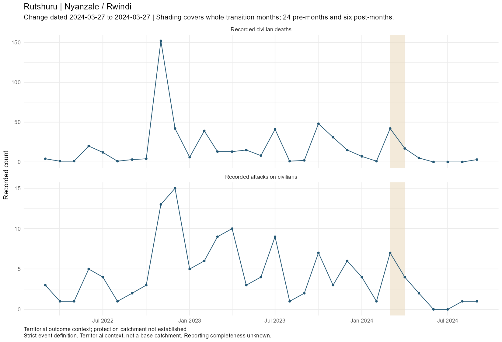

| definition | deaths_pre | deaths_post | events_pre | events_post | monthly_difference |
| --- | --- | --- | --- | --- | --- |
| strict | 480 | 25 | 118 | 8 | -15.833 |
| territorial | 531 | 26 | 131 | 9 | -17.792 |

**Timing and inclusion sensitivity**

| definition | scenario | deaths_pre | deaths_post | monthly_difference |
| --- | --- | --- | --- | --- |
| strict | earliest_documented_month | 480 | 25 | -15.833 |
| strict | latest_documented_month | 480 | 25 | -15.833 |
| territorial | earliest_documented_month | 531 | 26 | -17.792 |
| territorial | latest_documented_month | 531 | 26 | -17.792 |
| strict | main_interval_envelope | 480 | 25 | -15.833 |
| territorial | main_interval_envelope | 531 | 26 | -17.792 |

Largest pre/post event: 466770 ; deaths: 80 . Monthly difference after deleting that one event: -12.5 . All single-event-deletion differences range from -17.833 to -12.5 (sensitivity range, not an interval estimate).

Removing all known geography conflicts gives 476 pre deaths and 25 post deaths; monthly difference -15.667 . Unknown ADM2 remains unresolved.

**Largest saved event records in each non-transition block**

| block | id | start_date | deaths_civilians | where_description | admin_agrees |
| --- | --- | --- | --- | --- | --- |
| post_1_3 | 521534 | 2024-04-01 | 12 | Rwanguba and Bwuma | TRUE |
| post_1_3 | 524916 | 2024-05-26 | 4 | Lushege, capital of the Tongo groupement, in Rutshuru territory (North Kivu). | TRUE |
| post_1_3 | 565246 | 2024-04-18 | 3 | Kabaya, the capital of the Gisigari group in the Bwisha chiefdom in Rutshuru territory (North Kivu). | TRUE |
| post_4_6 | 565315 | 2024-09-03 | 3 | Kabuhendo, near the Tata Shamukungu stadium, not far from Kibirizi center, | TRUE |
| post_4_6 | 567356 | 2024-08-28 | 0 | unknown / not applicable | FALSE |
| pre_24 | 466770 | 2022-11-30 | 80 | Kishishe | TRUE |
| pre_24 | 509559 | 2023-10-21 | 37 | Marangara in the Tongo and Bishusha groups, in the Bwito chiefdom, in the Rutshuru territory in North Kivu  Tongo area of Rutshuru | TRUE |
| pre_24 | 466333 | 2023-02-26 | 32 | Kanyangiri, Nord-Kivu Tongo and the surroundings, in Bwito chieftaincy, Rutshuru Territory [Nord Kivu, eastern DR Congo]. | TRUE |

[s19: UN S/2024/482](https://documents.un.org/api/symbol/access?l=en&s=s%2F2024%2F482&t=pdf)

### Shabunda - Shabunda

Decision cluster: shabunda_2022 | Recorded transition: 2022-11-09 to 2022-11-10 | Feasibility class: 2

Descriptive only: Redeployment toward Ituri; subsequent listed strength unresolved | Territorial outcomes do not establish base protection catchment or a credible counterfactual.

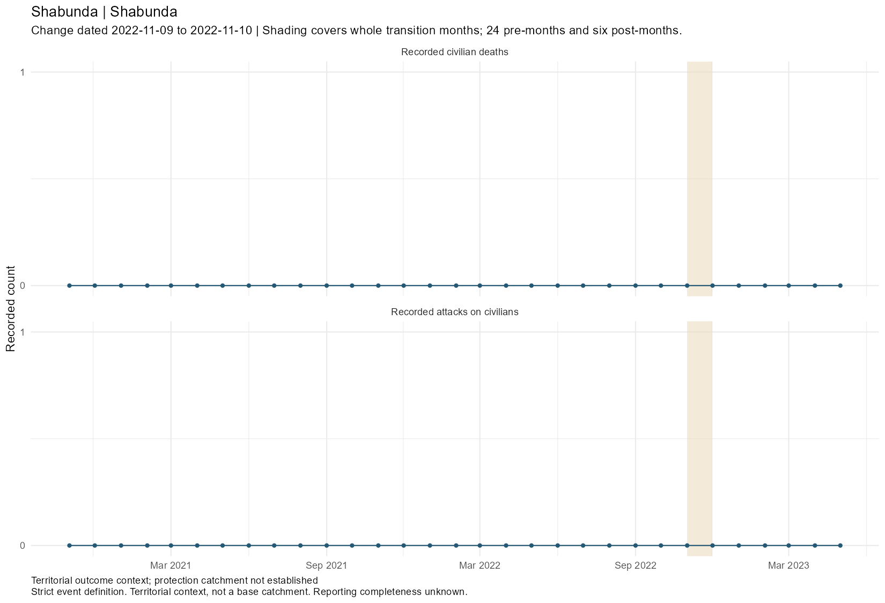

| definition | deaths_pre | deaths_post | events_pre | events_post | monthly_difference |
| --- | --- | --- | --- | --- | --- |
| strict | 0 | 0 | 0 | 0 | 0 |
| territorial | 0 | 0 | 0 | 0 | 0 |

**Timing and inclusion sensitivity**

| definition | scenario | deaths_pre | deaths_post | monthly_difference |
| --- | --- | --- | --- | --- |
| strict | earliest_documented_month | 0 | 0 | 0 |
| strict | latest_documented_month | 0 | 0 | 0 |
| territorial | earliest_documented_month | 0 | 0 | 0 |
| territorial | latest_documented_month | 0 | 0 | 0 |
| strict | main_interval_envelope | 0 | 0 | 0 |
| territorial | main_interval_envelope | 0 | 0 | 0 |

No retained pre/post event is available for an event-deletion calculation; this does not certify absence of violence.

Removing all known geography conflicts gives 0 pre deaths and 0 post deaths; monthly difference 0 . Unknown ADM2 remains unresolved.

**Largest saved event records in each non-transition block**

| block | id | start_date | deaths_civilians | where_description | admin_agrees |
| --- | --- | --- | --- | --- | --- |

[s14: Radio Okapi](https://www.radiookapi.net/2022/11/10/actualite/politique/sud-kivu-retrait-de-la-monusco-du-territoire-de-shabunda) ; [s15: Actualite.cd](https://actualite.cd/index.php/2022/11/11/sud-kivu-la-monusco-ferme-sa-base-shabunda)

### South Kivu protection operations - Idjwi

Decision cluster: south_kivu_2024 | Recorded transition: 2024-04-30 to 2024-04-30 | Feasibility class: 2

Descriptive only: Negotiated provincial withdrawal; one joint decision | Territorial outcomes do not establish base protection catchment or a credible counterfactual.

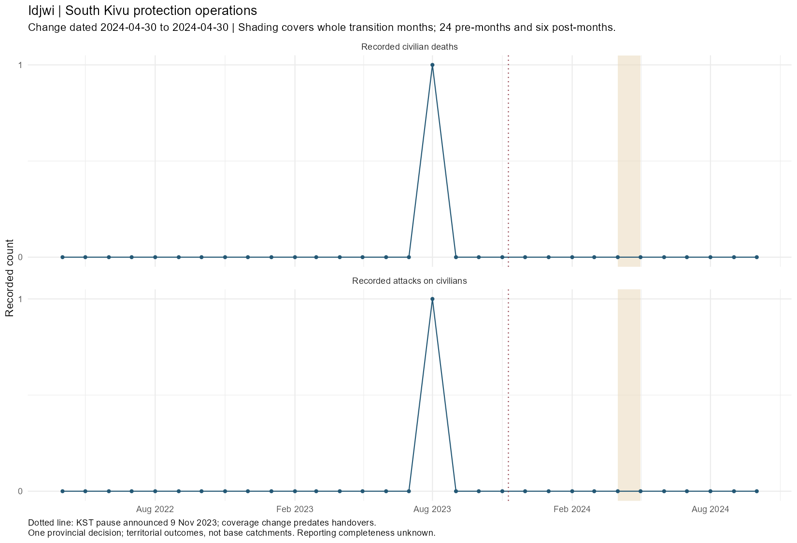

| definition | deaths_pre | deaths_post | events_pre | events_post | monthly_difference |
| --- | --- | --- | --- | --- | --- |
| strict | 1 | 0 | 1 | 0 | -0.042 |
| territorial | 1 | 0 | 1 | 0 | -0.042 |

**Timing and inclusion sensitivity**

| definition | scenario | deaths_pre | deaths_post | monthly_difference |
| --- | --- | --- | --- | --- |
| strict | earliest_documented_month | 1 | 0 | -0.042 |
| strict | latest_documented_month | 1 | 0 | -0.042 |
| territorial | earliest_documented_month | 1 | 0 | -0.042 |
| territorial | latest_documented_month | 1 | 0 | -0.042 |
| strict | main_interval_envelope | 1 | 0 | -0.042 |
| territorial | main_interval_envelope | 1 | 0 | -0.042 |

Largest pre/post event: 490476 ; deaths: 1 . Monthly difference after deleting that one event: 0 . All single-event-deletion differences range from 0 to 0 (sensitivity range, not an interval estimate).

Removing all known geography conflicts gives 1 pre deaths and 0 post deaths; monthly difference -0.042 . Unknown ADM2 remains unresolved.

**Largest saved event records in each non-transition block**

| block | id | start_date | deaths_civilians | where_description | admin_agrees |
| --- | --- | --- | --- | --- | --- |
| pre_24 | 490476 | 2023-08-31 | 1 | village of Lubuye in Idjwi territory | TRUE |

[s20: MONUSCO](https://monusco.unmissions.org/sites/default/files/pr_monusco_ceases_operations_in_south_kivu_province_30_april_2024.pdf) ; [s24: UN](https://peacekeeping.un.org/en/press-releases/monusco-ending-its-mission-in-south-kivu-after-more-than-20-years-of)

### Bunyakiri - Kalehe

Decision cluster: south_kivu_2024 | Recorded transition: 2024-04-19 to 2024-04-19 | Feasibility class: 2

Descriptive only: Part of same provincial withdrawal; ceremony is not independent treatment date | Territorial outcomes do not establish base protection catchment or a credible counterfactual.

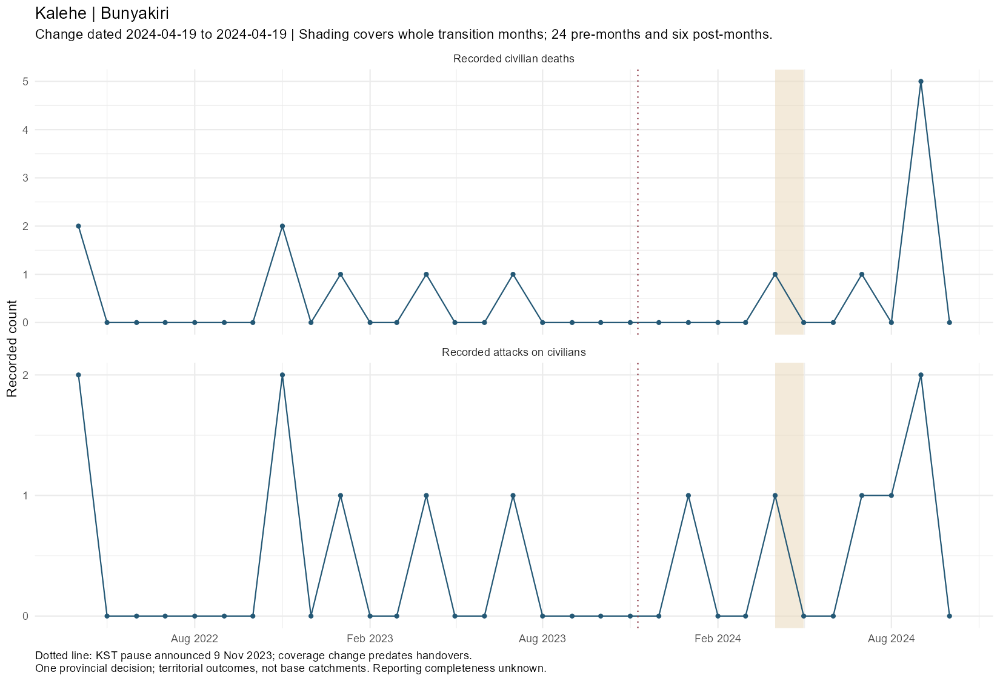

| definition | deaths_pre | deaths_post | events_pre | events_post | monthly_difference |
| --- | --- | --- | --- | --- | --- |
| strict | 7 | 6 | 8 | 4 | 0.708 |
| territorial | 7 | 9 | 8 | 6 | 1.208 |

**Timing and inclusion sensitivity**

| definition | scenario | deaths_pre | deaths_post | monthly_difference |
| --- | --- | --- | --- | --- |
| strict | earliest_documented_month | 7 | 6 | 0.708 |
| strict | latest_documented_month | 7 | 6 | 0.708 |
| territorial | earliest_documented_month | 7 | 9 | 1.208 |
| territorial | latest_documented_month | 7 | 9 | 1.208 |
| strict | main_interval_envelope | 7 | 6 | 0.708 |
| territorial | main_interval_envelope | 7 | 9 | 1.208 |

Largest pre/post event: 567319 ; deaths: 4 . Monthly difference after deleting that one event: 0.042 . All single-event-deletion differences range from 0.042 to 0.75 (sensitivity range, not an interval estimate).

Removing all known geography conflicts gives 7 pre deaths and 6 post deaths; monthly difference 0.708 . Unknown ADM2 remains unresolved.

**Largest saved event records in each non-transition block**

| block | id | start_date | deaths_civilians | where_description | admin_agrees |
| --- | --- | --- | --- | --- | --- |
| post_1_3 | 565245 | 2024-07-10 | 1 | Buganga, village of Bwisha at least 4 kilometers from the Minova shopping center on the national road N2, territory of Kalehe in the province of South Kivu. | TRUE |
| post_4_6 | 567319 | 2024-09-19 | 4 | Numbi, in the Buzi group, Buhavu chiefdom, Kalehe territory | TRUE |
| post_4_6 | 543153 | 2024-09-19 | 1 | Cholobera Square in Cifunzi Kalonge. | TRUE |
| post_4_6 | 565242 | 2024-08-29 | 0 | Buganga (Buhavu, Kalehe, Nord-Kivu) | TRUE |
| pre_24 | 434708 | 2022-04-02 | 1 | Lumbishi, Sud-Kivu | TRUE |
| pre_24 | 436177 | 2022-04-17 | 1 | Kasese village in Kalehe | TRUE |
| pre_24 | 456071 | 2022-11-18 | 1 | Lumbishi in Kalehe territory | TRUE |

[s19: UN S/2024/482](https://documents.un.org/api/symbol/access?l=en&s=s%2F2024%2F482&t=pdf) ; [r02: Protection Cluster April 2024](https://globalprotectioncluster.org/sites/default/files/2024-05/points_saillants_situation_de_protection_rdc_avril_2024_240523_.pdf)

### South Kivu protection operations - Kalehe

Decision cluster: south_kivu_2024 | Recorded transition: 2024-04-30 to 2024-04-30 | Feasibility class: 2

Descriptive only: Negotiated provincial withdrawal; one joint decision | Territorial outcomes do not establish base protection catchment or a credible counterfactual.

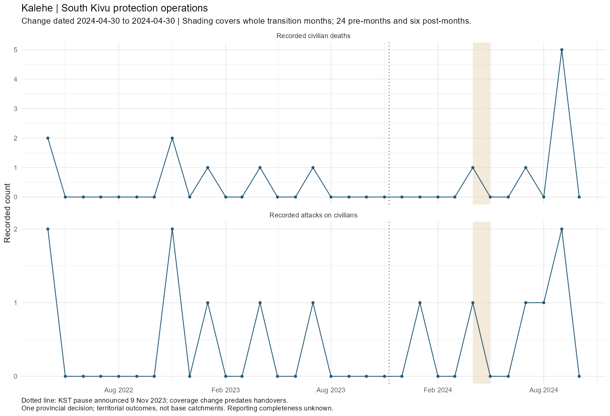

| definition | deaths_pre | deaths_post | events_pre | events_post | monthly_difference |
| --- | --- | --- | --- | --- | --- |
| strict | 7 | 6 | 8 | 4 | 0.708 |
| territorial | 7 | 9 | 8 | 6 | 1.208 |

**Timing and inclusion sensitivity**

| definition | scenario | deaths_pre | deaths_post | monthly_difference |
| --- | --- | --- | --- | --- |
| strict | earliest_documented_month | 7 | 6 | 0.708 |
| strict | latest_documented_month | 7 | 6 | 0.708 |
| territorial | earliest_documented_month | 7 | 9 | 1.208 |
| territorial | latest_documented_month | 7 | 9 | 1.208 |
| strict | main_interval_envelope | 7 | 6 | 0.708 |
| territorial | main_interval_envelope | 7 | 9 | 1.208 |

Largest pre/post event: 567319 ; deaths: 4 . Monthly difference after deleting that one event: 0.042 . All single-event-deletion differences range from 0.042 to 0.75 (sensitivity range, not an interval estimate).

Removing all known geography conflicts gives 7 pre deaths and 6 post deaths; monthly difference 0.708 . Unknown ADM2 remains unresolved.

**Largest saved event records in each non-transition block**

| block | id | start_date | deaths_civilians | where_description | admin_agrees |
| --- | --- | --- | --- | --- | --- |
| post_1_3 | 565245 | 2024-07-10 | 1 | Buganga, village of Bwisha at least 4 kilometers from the Minova shopping center on the national road N2, territory of Kalehe in the province of South Kivu. | TRUE |
| post_4_6 | 567319 | 2024-09-19 | 4 | Numbi, in the Buzi group, Buhavu chiefdom, Kalehe territory | TRUE |
| post_4_6 | 543153 | 2024-09-19 | 1 | Cholobera Square in Cifunzi Kalonge. | TRUE |
| post_4_6 | 565242 | 2024-08-29 | 0 | Buganga (Buhavu, Kalehe, Nord-Kivu) | TRUE |
| pre_24 | 434708 | 2022-04-02 | 1 | Lumbishi, Sud-Kivu | TRUE |
| pre_24 | 436177 | 2022-04-17 | 1 | Kasese village in Kalehe | TRUE |
| pre_24 | 456071 | 2022-11-18 | 1 | Lumbishi in Kalehe territory | TRUE |

[s20: MONUSCO](https://monusco.unmissions.org/sites/default/files/pr_monusco_ceases_operations_in_south_kivu_province_30_april_2024.pdf) ; [s24: UN](https://peacekeeping.un.org/en/press-releases/monusco-ending-its-mission-in-south-kivu-after-more-than-20-years-of)

### Kamanyola - Walungu

Decision cluster: south_kivu_2024 | Recorded transition: 2024-02-28 to 2024-02-28 | Feasibility class: 2

Descriptive only: Part of same provincial withdrawal; ceremony is not independent treatment date | Territorial outcomes do not establish base protection catchment or a credible counterfactual.

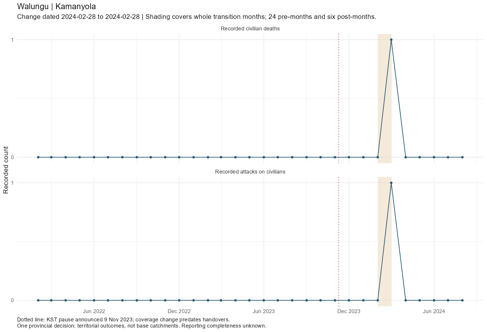

| definition | deaths_pre | deaths_post | events_pre | events_post | monthly_difference |
| --- | --- | --- | --- | --- | --- |
| strict | 0 | 1 | 0 | 1 | 0.167 |
| territorial | 0 | 1 | 0 | 1 | 0.167 |

**Timing and inclusion sensitivity**

| definition | scenario | deaths_pre | deaths_post | monthly_difference |
| --- | --- | --- | --- | --- |
| strict | earliest_documented_month | 0 | 1 | 0.167 |
| strict | latest_documented_month | 0 | 1 | 0.167 |
| territorial | earliest_documented_month | 0 | 1 | 0.167 |
| territorial | latest_documented_month | 0 | 1 | 0.167 |
| strict | main_interval_envelope | 0 | 1 | 0.167 |
| territorial | main_interval_envelope | 0 | 1 | 0.167 |

Largest pre/post event: 519156 ; deaths: 1 . Monthly difference after deleting that one event: 0 . All single-event-deletion differences range from 0 to 0 (sensitivity range, not an interval estimate).

Removing all known geography conflicts gives 0 pre deaths and 1 post deaths; monthly difference 0.167 . Unknown ADM2 remains unresolved.

**Largest saved event records in each non-transition block**

| block | id | start_date | deaths_civilians | where_description | admin_agrees |
| --- | --- | --- | --- | --- | --- |
| post_1_3 | 519156 | 2024-03-26 | 1 | Nyangezi, Walungu | TRUE |

[s21: UN S/2024/251](https://monusco.unmissions.org/sites/default/files/s-2024-251_en.pdf)

### South Kivu protection operations - Walungu

Decision cluster: south_kivu_2024 | Recorded transition: 2024-04-30 to 2024-04-30 | Feasibility class: 2

Descriptive only: Negotiated provincial withdrawal; one joint decision | Territorial outcomes do not establish base protection catchment or a credible counterfactual.

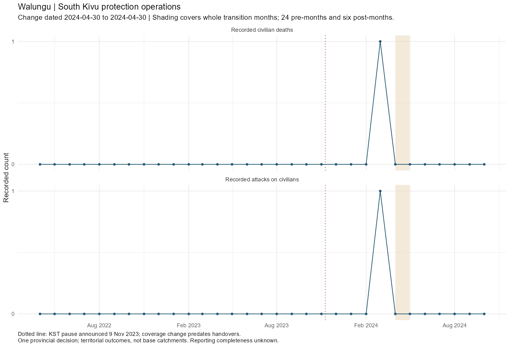

| definition | deaths_pre | deaths_post | events_pre | events_post | monthly_difference |
| --- | --- | --- | --- | --- | --- |
| strict | 1 | 0 | 1 | 0 | -0.042 |
| territorial | 1 | 0 | 1 | 0 | -0.042 |

**Timing and inclusion sensitivity**

| definition | scenario | deaths_pre | deaths_post | monthly_difference |
| --- | --- | --- | --- | --- |
| strict | earliest_documented_month | 1 | 0 | -0.042 |
| strict | latest_documented_month | 1 | 0 | -0.042 |
| territorial | earliest_documented_month | 1 | 0 | -0.042 |
| territorial | latest_documented_month | 1 | 0 | -0.042 |
| strict | main_interval_envelope | 1 | 0 | -0.042 |
| territorial | main_interval_envelope | 1 | 0 | -0.042 |

Largest pre/post event: 519156 ; deaths: 1 . Monthly difference after deleting that one event: 0 . All single-event-deletion differences range from 0 to 0 (sensitivity range, not an interval estimate).

Removing all known geography conflicts gives 1 pre deaths and 0 post deaths; monthly difference -0.042 . Unknown ADM2 remains unresolved.

**Largest saved event records in each non-transition block**

| block | id | start_date | deaths_civilians | where_description | admin_agrees |
| --- | --- | --- | --- | --- | --- |
| pre_24 | 519156 | 2024-03-26 | 1 | Nyangezi, Walungu | TRUE |

[s20: MONUSCO](https://monusco.unmissions.org/sites/default/files/pr_monusco_ceases_operations_in_south_kivu_province_30_april_2024.pdf) ; [s24: UN](https://peacekeeping.un.org/en/press-releases/monusco-ending-its-mission-in-south-kivu-after-more-than-20-years-of)

### South Kivu protection operations - Mwenga

Decision cluster: south_kivu_2024 | Recorded transition: 2024-04-30 to 2024-04-30 | Feasibility class: 2

Descriptive only: Negotiated provincial withdrawal; one joint decision | Territorial outcomes do not establish base protection catchment or a credible counterfactual.

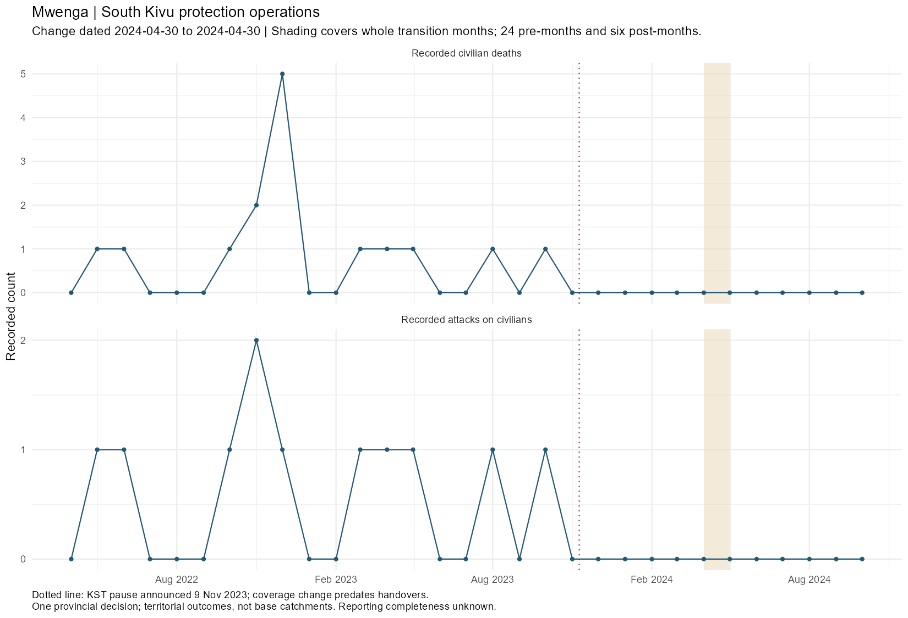

| definition | deaths_pre | deaths_post | events_pre | events_post | monthly_difference |
| --- | --- | --- | --- | --- | --- |
| strict | 15 | 0 | 11 | 0 | -0.625 |
| territorial | 16 | 0 | 12 | 1 | -0.667 |

**Timing and inclusion sensitivity**

| definition | scenario | deaths_pre | deaths_post | monthly_difference |
| --- | --- | --- | --- | --- |
| strict | earliest_documented_month | 15 | 0 | -0.625 |
| strict | latest_documented_month | 15 | 0 | -0.625 |
| territorial | earliest_documented_month | 16 | 0 | -0.667 |
| territorial | latest_documented_month | 16 | 0 | -0.667 |
| strict | main_interval_envelope | 15 | 0 | -0.625 |
| territorial | main_interval_envelope | 16 | 0 | -0.667 |

Largest pre/post event: 460058 ; deaths: 5 . Monthly difference after deleting that one event: -0.417 . All single-event-deletion differences range from -0.583 to -0.417 (sensitivity range, not an interval estimate).

Removing all known geography conflicts gives 11 pre deaths and 0 post deaths; monthly difference -0.458 . Unknown ADM2 remains unresolved.

**Largest saved event records in each non-transition block**

| block | id | start_date | deaths_civilians | where_description | admin_agrees |
| --- | --- | --- | --- | --- | --- |
| pre_24 | 460058 | 2022-12-14 | 5 | Mikenge | TRUE |
| pre_24 | 441681 | 2022-05-15 | 1 | Kakuku village in Mwenga territory | TRUE |
| pre_24 | 441761 | 2022-06-09 | 1 | Mitobo village in Mwenga territory. | TRUE |

[s20: MONUSCO](https://monusco.unmissions.org/sites/default/files/pr_monusco_ceases_operations_in_south_kivu_province_30_april_2024.pdf) ; [s24: UN](https://peacekeeping.un.org/en/press-releases/monusco-ending-its-mission-in-south-kivu-after-more-than-20-years-of)

### South Kivu protection operations - Shabunda

Decision cluster: south_kivu_2024 | Recorded transition: 2024-04-30 to 2024-04-30 | Feasibility class: 2

Descriptive only: Negotiated provincial withdrawal; one joint decision | Territorial outcomes do not establish base protection catchment or a credible counterfactual.

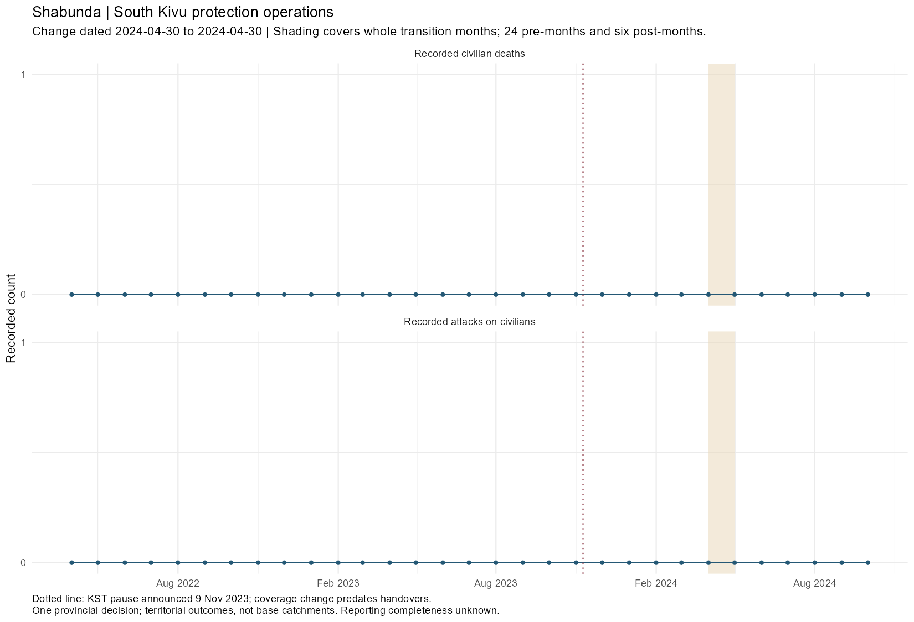

| definition | deaths_pre | deaths_post | events_pre | events_post | monthly_difference |
| --- | --- | --- | --- | --- | --- |
| strict | 0 | 0 | 0 | 0 | 0.000 |
| territorial | 1 | 0 | 1 | 0 | -0.042 |

**Timing and inclusion sensitivity**

| definition | scenario | deaths_pre | deaths_post | monthly_difference |
| --- | --- | --- | --- | --- |
| strict | earliest_documented_month | 0 | 0 | 0.000 |
| strict | latest_documented_month | 0 | 0 | 0.000 |
| territorial | earliest_documented_month | 1 | 0 | -0.042 |
| territorial | latest_documented_month | 1 | 0 | -0.042 |
| strict | main_interval_envelope | 0 | 0 | 0.000 |
| territorial | main_interval_envelope | 1 | 0 | -0.042 |

No retained pre/post event is available for an event-deletion calculation; this does not certify absence of violence.

Removing all known geography conflicts gives 0 pre deaths and 0 post deaths; monthly difference 0 . Unknown ADM2 remains unresolved.

**Largest saved event records in each non-transition block**

| block | id | start_date | deaths_civilians | where_description | admin_agrees |
| --- | --- | --- | --- | --- | --- |

[s20: MONUSCO](https://monusco.unmissions.org/sites/default/files/pr_monusco_ceases_operations_in_south_kivu_province_30_april_2024.pdf) ; [s24: UN](https://peacekeeping.un.org/en/press-releases/monusco-ending-its-mission-in-south-kivu-after-more-than-20-years-of)

### South Kivu protection operations - Fizi including Baraka

Decision cluster: south_kivu_2024 | Recorded transition: 2024-04-30 to 2024-04-30 | Feasibility class: 2

Descriptive only: Negotiated provincial withdrawal; one joint decision | Territorial outcomes do not establish base protection catchment or a credible counterfactual.

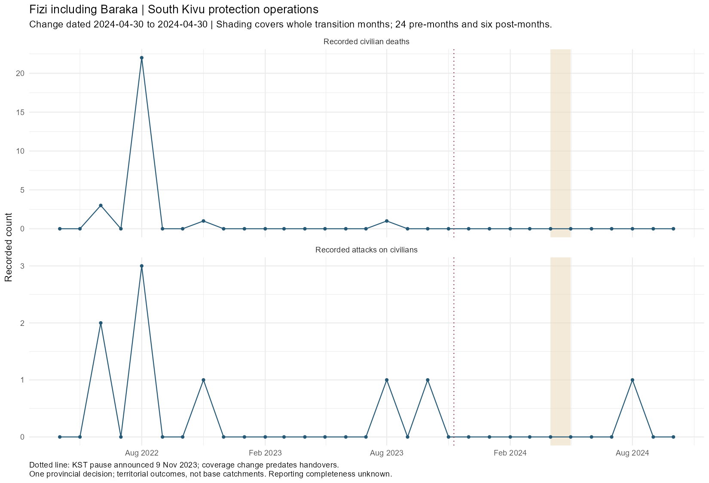

| definition | deaths_pre | deaths_post | events_pre | events_post | monthly_difference |
| --- | --- | --- | --- | --- | --- |
| strict | 27 | 0 | 8 | 1 | -1.125 |
| territorial | 27 | 0 | 8 | 1 | -1.125 |

**Timing and inclusion sensitivity**

| definition | scenario | deaths_pre | deaths_post | monthly_difference |
| --- | --- | --- | --- | --- |
| strict | earliest_documented_month | 27 | 0 | -1.125 |
| strict | latest_documented_month | 27 | 0 | -1.125 |
| territorial | earliest_documented_month | 27 | 0 | -1.125 |
| territorial | latest_documented_month | 27 | 0 | -1.125 |
| strict | main_interval_envelope | 27 | 0 | -1.125 |
| territorial | main_interval_envelope | 27 | 0 | -1.125 |

Largest pre/post event: 446595 ; deaths: 14 . Monthly difference after deleting that one event: -0.542 . All single-event-deletion differences range from -1.125 to -0.542 (sensitivity range, not an interval estimate).

Removing all known geography conflicts gives 27 pre deaths and 0 post deaths; monthly difference -1.125 . Unknown ADM2 remains unresolved.

**Largest saved event records in each non-transition block**

| block | id | start_date | deaths_civilians | where_description | admin_agrees |
| --- | --- | --- | --- | --- | --- |
| post_4_6 | 538744 | 2024-08-12 | 0 | Misisi, South Kivu | TRUE |
| pre_24 | 446595 | 2022-08-17 | 14 | Bigaragara, a locality in the Mutambala sector, in the territory of Fizi | TRUE |
| pre_24 | 446471 | 2022-08-17 | 7 | Tulendo mining site in Fizi territory | TRUE |
| pre_24 | 441732 | 2022-06-01 | 2 | Nakisoki village in Fizi territory. | TRUE |

[s20: MONUSCO](https://monusco.unmissions.org/sites/default/files/pr_monusco_ceases_operations_in_south_kivu_province_30_april_2024.pdf) ; [s24: UN](https://peacekeeping.un.org/en/press-releases/monusco-ending-its-mission-in-south-kivu-after-more-than-20-years-of)

### Baraka - Fizi including Baraka

Decision cluster: south_kivu_2024 | Recorded transition: 2024-05-06 to 2024-05-06 | Feasibility class: 2

Descriptive only: Part of same provincial withdrawal; ceremony is not independent treatment date | Territorial outcomes do not establish base protection catchment or a credible counterfactual.

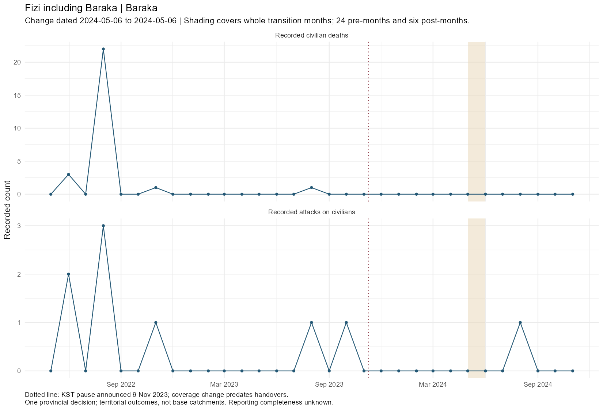

| definition | deaths_pre | deaths_post | events_pre | events_post | monthly_difference |
| --- | --- | --- | --- | --- | --- |
| strict | 27 | 0 | 8 | 1 | -1.125 |
| territorial | 27 | 0 | 8 | 1 | -1.125 |

**Timing and inclusion sensitivity**

| definition | scenario | deaths_pre | deaths_post | monthly_difference |
| --- | --- | --- | --- | --- |
| strict | earliest_documented_month | 27 | 0 | -1.125 |
| strict | latest_documented_month | 27 | 0 | -1.125 |
| territorial | earliest_documented_month | 27 | 0 | -1.125 |
| territorial | latest_documented_month | 27 | 0 | -1.125 |
| strict | main_interval_envelope | 27 | 0 | -1.125 |
| territorial | main_interval_envelope | 27 | 0 | -1.125 |

Largest pre/post event: 446595 ; deaths: 14 . Monthly difference after deleting that one event: -0.542 . All single-event-deletion differences range from -1.125 to -0.542 (sensitivity range, not an interval estimate).

Removing all known geography conflicts gives 27 pre deaths and 0 post deaths; monthly difference -1.125 . Unknown ADM2 remains unresolved.

**Largest saved event records in each non-transition block**

| block | id | start_date | deaths_civilians | where_description | admin_agrees |
| --- | --- | --- | --- | --- | --- |
| post_1_3 | 538744 | 2024-08-12 | 0 | Misisi, South Kivu | TRUE |
| pre_24 | 446595 | 2022-08-17 | 14 | Bigaragara, a locality in the Mutambala sector, in the territory of Fizi | TRUE |
| pre_24 | 446471 | 2022-08-17 | 7 | Tulendo mining site in Fizi territory | TRUE |
| pre_24 | 441732 | 2022-06-01 | 2 | Nakisoki village in Fizi territory. | TRUE |

[s22: Radio Okapi](https://www.radiookapi.net/2024/05/07/actualite/securite/sud-kivu-depart-des-casque-bleus-pakistanais-de-la-monusco-apres-la)

### Kavumu airport - Kabare including Bukavu

Decision cluster: south_kivu_2024 | Recorded transition: 2024-04-25 to 2024-04-25 | Feasibility class: 3

Documentary only: Airport security / property distinct from community protection | Timing or community-protection exposure remains unverified.

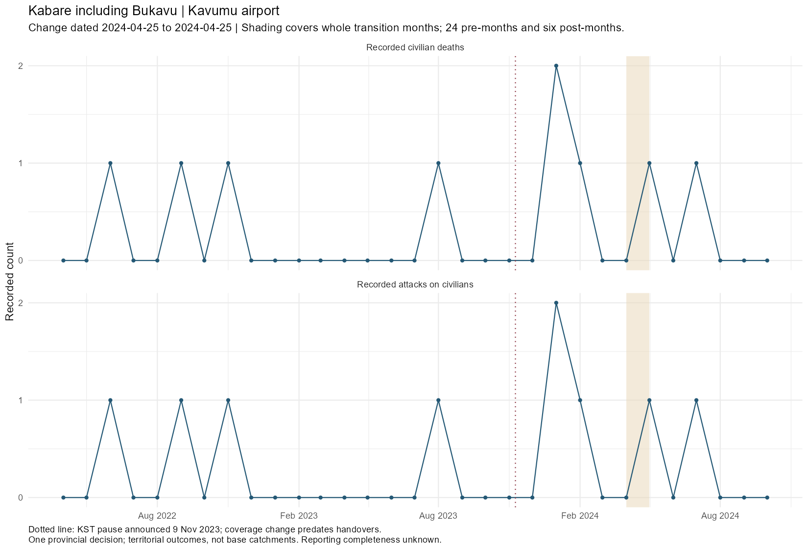

| definition | deaths_pre | deaths_post | events_pre | events_post | monthly_difference |
| --- | --- | --- | --- | --- | --- |
| strict | 7 | 2 | 7 | 2 | 0.042 |
| territorial | 7 | 2 | 7 | 2 | 0.042 |

**Timing and inclusion sensitivity**

| definition | scenario | deaths_pre | deaths_post | monthly_difference |
| --- | --- | --- | --- | --- |
| strict | earliest_documented_month | 7 | 2 | 0.042 |
| strict | latest_documented_month | 7 | 2 | 0.042 |
| territorial | earliest_documented_month | 7 | 2 | 0.042 |
| territorial | latest_documented_month | 7 | 2 | 0.042 |
| strict | main_interval_envelope | 7 | 2 | 0.042 |
| territorial | main_interval_envelope | 7 | 2 | 0.042 |

Largest pre/post event: 441799 ; deaths: 1 . Monthly difference after deleting that one event: 0.083 . All single-event-deletion differences range from -0.125 to 0.083 (sensitivity range, not an interval estimate).

Removing all known geography conflicts gives 7 pre deaths and 2 post deaths; monthly difference 0.042 . Unknown ADM2 remains unresolved.

**Largest saved event records in each non-transition block**

| block | id | start_date | deaths_civilians | where_description | admin_agrees |
| --- | --- | --- | --- | --- | --- |
| post_1_3 | 524907 | 2024-05-21 | 1 | Katana, Kabare territory (South Kivu). | TRUE |
| post_1_3 | 565244 | 2024-07-16 | 1 | Michombero Avenue in the Nkafu district in the commune of Kadutu | TRUE |
| pre_24 | 441799 | 2022-06-14 | 1 | Bukavu, Sud-Kivu | TRUE |
| pre_24 | 447886 | 2022-09-03 | 1 | Ndendere district of Bukavu. | TRUE |
| pre_24 | 455924 | 2022-11-12 | 1 | Businde in Kabare territory. | TRUE |

[s19: UN S/2024/482](https://documents.un.org/api/symbol/access?l=en&s=s%2F2024%2F482&t=pdf)

### South Kivu protection operations - Kabare including Bukavu

Decision cluster: south_kivu_2024 | Recorded transition: 2024-04-30 to 2024-04-30 | Feasibility class: 2

Descriptive only: Negotiated provincial withdrawal; one joint decision | Territorial outcomes do not establish base protection catchment or a credible counterfactual.

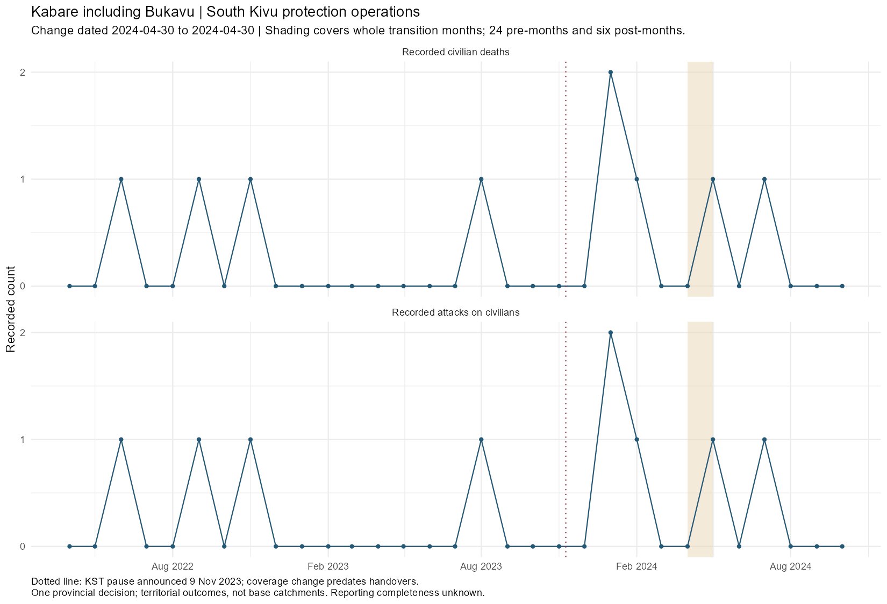

| definition | deaths_pre | deaths_post | events_pre | events_post | monthly_difference |
| --- | --- | --- | --- | --- | --- |
| strict | 7 | 2 | 7 | 2 | 0.042 |
| territorial | 7 | 2 | 7 | 2 | 0.042 |

**Timing and inclusion sensitivity**

| definition | scenario | deaths_pre | deaths_post | monthly_difference |
| --- | --- | --- | --- | --- |
| strict | earliest_documented_month | 7 | 2 | 0.042 |
| strict | latest_documented_month | 7 | 2 | 0.042 |
| territorial | earliest_documented_month | 7 | 2 | 0.042 |
| territorial | latest_documented_month | 7 | 2 | 0.042 |
| strict | main_interval_envelope | 7 | 2 | 0.042 |
| territorial | main_interval_envelope | 7 | 2 | 0.042 |

Largest pre/post event: 441799 ; deaths: 1 . Monthly difference after deleting that one event: 0.083 . All single-event-deletion differences range from -0.125 to 0.083 (sensitivity range, not an interval estimate).

Removing all known geography conflicts gives 7 pre deaths and 2 post deaths; monthly difference 0.042 . Unknown ADM2 remains unresolved.

**Largest saved event records in each non-transition block**

| block | id | start_date | deaths_civilians | where_description | admin_agrees |
| --- | --- | --- | --- | --- | --- |
| post_1_3 | 524907 | 2024-05-21 | 1 | Katana, Kabare territory (South Kivu). | TRUE |
| post_1_3 | 565244 | 2024-07-16 | 1 | Michombero Avenue in the Nkafu district in the commune of Kadutu | TRUE |
| pre_24 | 441799 | 2022-06-14 | 1 | Bukavu, Sud-Kivu | TRUE |
| pre_24 | 447886 | 2022-09-03 | 1 | Ndendere district of Bukavu. | TRUE |
| pre_24 | 455924 | 2022-11-12 | 1 | Businde in Kabare territory. | TRUE |

[s20: MONUSCO](https://monusco.unmissions.org/sites/default/files/pr_monusco_ceases_operations_in_south_kivu_province_30_april_2024.pdf) ; [s24: UN](https://peacekeeping.un.org/en/press-releases/monusco-ending-its-mission-in-south-kivu-after-more-than-20-years-of)

### Bukavu office - Kabare including Bukavu

Decision cluster: south_kivu_2024 | Recorded transition: 2024-06-25 to 2024-06-25 | Feasibility class: 3

Documentary only: Administrative closure after provincial protection cessation | Timing or community-protection exposure remains unverified.

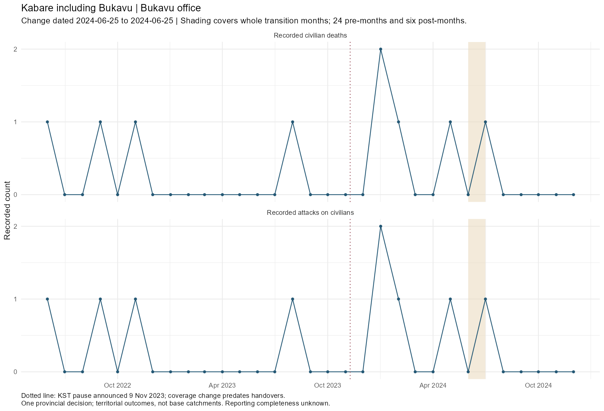

| definition | deaths_pre | deaths_post | events_pre | events_post | monthly_difference |
| --- | --- | --- | --- | --- | --- |
| strict | 8 | 1 | 8 | 1 | -0.167 |
| territorial | 8 | 1 | 8 | 1 | -0.167 |

**Timing and inclusion sensitivity**

| definition | scenario | deaths_pre | deaths_post | monthly_difference |
| --- | --- | --- | --- | --- |
| strict | earliest_documented_month | 8 | 1 | -0.167 |
| strict | latest_documented_month | 8 | 1 | -0.167 |
| territorial | earliest_documented_month | 8 | 1 | -0.167 |
| territorial | latest_documented_month | 8 | 1 | -0.167 |
| strict | main_interval_envelope | 8 | 1 | -0.167 |
| territorial | main_interval_envelope | 8 | 1 | -0.167 |

Largest pre/post event: 441799 ; deaths: 1 . Monthly difference after deleting that one event: -0.125 . All single-event-deletion differences range from -0.333 to -0.125 (sensitivity range, not an interval estimate).

Removing all known geography conflicts gives 8 pre deaths and 1 post deaths; monthly difference -0.167 . Unknown ADM2 remains unresolved.

**Largest saved event records in each non-transition block**

| block | id | start_date | deaths_civilians | where_description | admin_agrees |
| --- | --- | --- | --- | --- | --- |
| post_1_3 | 565244 | 2024-07-16 | 1 | Michombero Avenue in the Nkafu district in the commune of Kadutu | TRUE |
| pre_24 | 441799 | 2022-06-14 | 1 | Bukavu, Sud-Kivu | TRUE |
| pre_24 | 447886 | 2022-09-03 | 1 | Ndendere district of Bukavu. | TRUE |
| pre_24 | 455924 | 2022-11-12 | 1 | Businde in Kabare territory. | TRUE |

[s24: UN](https://peacekeeping.un.org/en/press-releases/monusco-ending-its-mission-in-south-kivu-after-more-than-20-years-of)

### South Kivu protection operations - Uvira including city

Decision cluster: south_kivu_2024 | Recorded transition: 2024-04-30 to 2024-04-30 | Feasibility class: 2

Descriptive only: Negotiated provincial withdrawal; one joint decision | Territorial outcomes do not establish base protection catchment or a credible counterfactual.

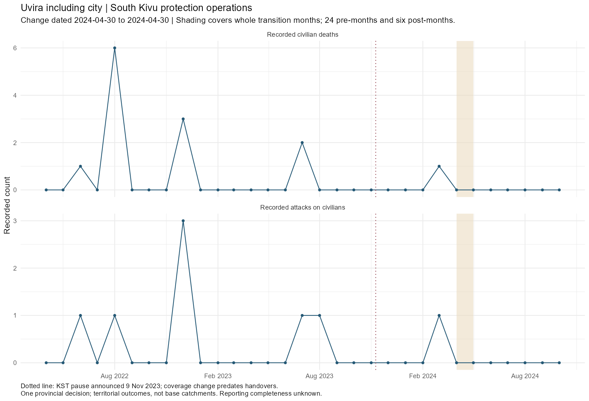

| definition | deaths_pre | deaths_post | events_pre | events_post | monthly_difference |
| --- | --- | --- | --- | --- | --- |
| strict | 13 | 0 | 8 | 0 | -0.542 |
| territorial | 13 | 0 | 8 | 0 | -0.542 |

**Timing and inclusion sensitivity**

| definition | scenario | deaths_pre | deaths_post | monthly_difference |
| --- | --- | --- | --- | --- |
| strict | earliest_documented_month | 13 | 0 | -0.542 |
| strict | latest_documented_month | 13 | 0 | -0.542 |
| territorial | earliest_documented_month | 13 | 0 | -0.542 |
| territorial | latest_documented_month | 13 | 0 | -0.542 |
| strict | main_interval_envelope | 13 | 0 | -0.542 |
| territorial | main_interval_envelope | 13 | 0 | -0.542 |

Largest pre/post event: 446605 ; deaths: 6 . Monthly difference after deleting that one event: -0.292 . All single-event-deletion differences range from -0.542 to -0.292 (sensitivity range, not an interval estimate).

Removing all known geography conflicts gives 13 pre deaths and 0 post deaths; monthly difference -0.542 . Unknown ADM2 remains unresolved.

**Largest saved event records in each non-transition block**

| block | id | start_date | deaths_civilians | where_description | admin_agrees |
| --- | --- | --- | --- | --- | --- |
| pre_24 | 446605 | 2022-08-17 | 6 | Bijombo | TRUE |
| pre_24 | 483512 | 2023-07-09 | 2 | Kirungu in Uvira | TRUE |
| pre_24 | 441755 | 2022-06-07 | 1 | Rombe I district of Uvira. | TRUE |

[s20: MONUSCO](https://monusco.unmissions.org/sites/default/files/pr_monusco_ceases_operations_in_south_kivu_province_30_april_2024.pdf) ; [s24: UN](https://peacekeeping.un.org/en/press-releases/monusco-ending-its-mission-in-south-kivu-after-more-than-20-years-of)

### Sange - Uvira including city

Decision cluster: south_kivu_2024 | Recorded transition: 2024-05-25 to 2024-05-25 | Feasibility class: 2

Descriptive only: Part of same provincial withdrawal; ceremony is not independent treatment date | Territorial outcomes do not establish base protection catchment or a credible counterfactual.

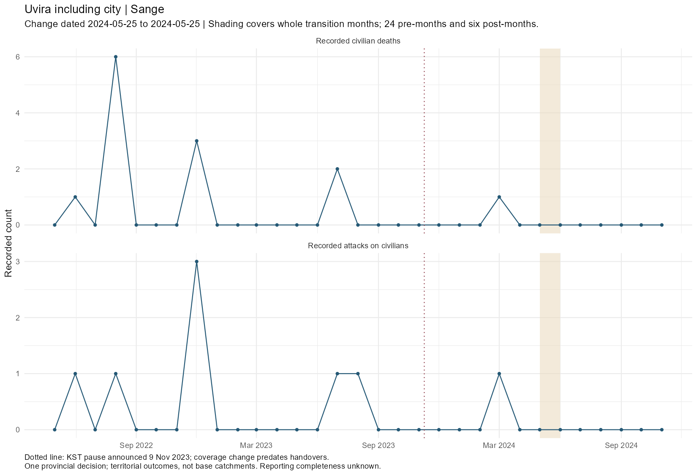

| definition | deaths_pre | deaths_post | events_pre | events_post | monthly_difference |
| --- | --- | --- | --- | --- | --- |
| strict | 13 | 0 | 8 | 0 | -0.542 |
| territorial | 13 | 0 | 8 | 1 | -0.542 |

**Timing and inclusion sensitivity**

| definition | scenario | deaths_pre | deaths_post | monthly_difference |
| --- | --- | --- | --- | --- |
| strict | earliest_documented_month | 13 | 0 | -0.542 |
| strict | latest_documented_month | 13 | 0 | -0.542 |
| territorial | earliest_documented_month | 13 | 0 | -0.542 |
| territorial | latest_documented_month | 13 | 0 | -0.542 |
| strict | main_interval_envelope | 13 | 0 | -0.542 |
| territorial | main_interval_envelope | 13 | 0 | -0.542 |

Largest pre/post event: 446605 ; deaths: 6 . Monthly difference after deleting that one event: -0.292 . All single-event-deletion differences range from -0.542 to -0.292 (sensitivity range, not an interval estimate).

Removing all known geography conflicts gives 13 pre deaths and 0 post deaths; monthly difference -0.542 . Unknown ADM2 remains unresolved.

**Largest saved event records in each non-transition block**

| block | id | start_date | deaths_civilians | where_description | admin_agrees |
| --- | --- | --- | --- | --- | --- |
| pre_24 | 446605 | 2022-08-17 | 6 | Bijombo | TRUE |
| pre_24 | 483512 | 2023-07-09 | 2 | Kirungu in Uvira | TRUE |
| pre_24 | 441755 | 2022-06-07 | 1 | Rombe I district of Uvira. | TRUE |

[s23: Radio Okapi](https://www.radiookapi.net/2024/05/28/actualite/securite/desengagement-de-la-monusco-les-casques-bleus-pakistanais-quittent-la-base-de-sange)

## Reproduction

Run from the project root with the established R library:

```r
source("scripts/build_withdrawal_descriptive_evidence.R")
source("scripts/validate_withdrawal_descriptive_evidence.R")
source("scripts/write_withdrawal_descriptive_packet.R")
```

The upstream feasibility audit must already exist and its input hashes must match. Its workflow reconstructs the original geography and inclusion rules. No raw GED redistribution is required to inspect this packet; local inputs remain in their existing ignored data directories.
