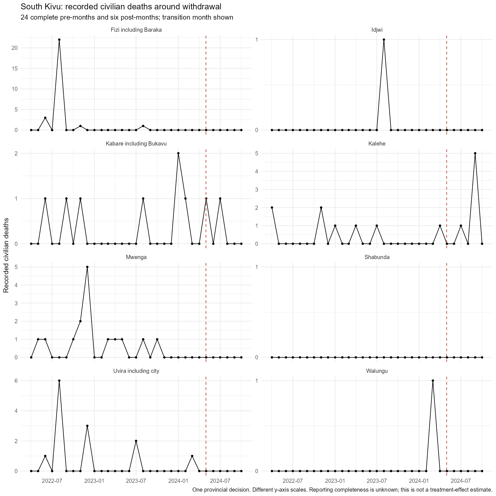

# MONUSCO withdrawal and civilian protection: feasibility decision

11 November 2026. First implementation milestone. No new effect model fitted.

**The audit establishes a usable documentary and descriptive study, but does not yet establish a credible causal withdrawal comparison.** After the [protection-area and reporting follow-up](withdrawal_protection_coverage_followup.md), the register contains 36 entries across 15 provisional decision clusters: 21 entries support descriptive longitudinal follow-up and 15 remain documentary only. Pinga was downgraded because closure-month and territorial claims conflict. None currently clears the comparative-causal criteria. These are not 36 verified withdrawals or 15 independent experiments: entries include plans, administrative changes, component handovers, and a provincial parent decision. The cluster assignments conservatively identify obvious shared decisions; their independence is not proven.

The active question is the overall consequence of withdrawal under the replacement arrangements that actually occurred. The old troop-strength regressions remain background evidence about a different association. Forecasting, review-slot optimization, and further spline searches are outside this work package. Existing analyses and source files remain preserved; the class paper and PowerPoint were not edited.

## What the register establishes

The [episode register](../data/withdrawal_feasibility/episode_register.csv) distinguishes announcement, planned closure, observed change interval, formal transfer, actual departure where known, and last documented protection activity. Blank dates mean unknown. A ceremony or a missing map listing is not silently converted into the last day of protection. Most last-patrol dates remain unavailable.

| Episode group | Evidence and current decision |
|---|---|
| Kashebere 2016; Pinga, Katale/Munigi and Ituri 2017 | Documentary only. Plans lack verified completion; Pinga has conflicting month and territorial claims. |
| Five North Kivu fixed-base closures, 2017 | Descriptive. The interval remains broad pending final-departure reconciliation. Follow-up finds named mobile deployments, including at closed-base settlements; territorial absence is not a defensible treatment code. |
| Mutarule 2018 | Descriptive. Dismantling was accompanied by intended patrols from Sange and Kamanyola. |
| Provincial offices 2019; Kasai 2021; Tanganyika 2022 | Documentary in this project. Administrative functions and/or geography do not match the existing protection outcome panel. |
| Lusenda 2021; Butembo, Rumangabo, Shabunda 2022 | Descriptive with explicit limitations: residual presence, protest-driven redeployment, military retreat, or conflicting listings. |
| Mutwanga, Kamango, Lubero 2023 | Descriptive. Dates are usable, but security-based selection and remaining protection inside the same territorial unit undermine an untreated comparison. |
| Nyanzale/Rwindi and Sake positions, 2024 | Descriptive conflict histories; simultaneous operations make attribution untenable with this design. |
| South Kivu protection cessation and base handovers, 2024 | One provincial transition, with component timelines. Bunyakiri, Sange and other confirmed base closures support description; airport/office transfers and incompletely dated departures remain documentary evidence about mechanisms. |

Every entry has source IDs and a short decision reason. The [source register](../data/withdrawal_feasibility/sources.csv) contains the corresponding URLs and bounded claims. The [year-by-year search coverage](../data/withdrawal_feasibility/search_coverage.csv) records unresolved gaps. This is a targeted feasibility register, not an exhaustive national census. In particular, no newly dated 2020 closure was confirmed; that does not establish that none occurred. Some websites were available through indexed text rather than a stable downloadable original; the register is not an archive of contemporaneously captured pages.

The 2017 reconfiguration merits further documentary attention because it reaches beyond the three familiar handovers. However, [CIVIC's field research](https://civiliansinconflict.org/wp-content/uploads/2018/02/Protection-Mandate-French-Translation-Web.pdf) describes reduced fixed presence, not disappearance of every protective activity. [October reporting](https://www.radiookapi.net/2017/10/19/actualite/securite/nord-kivu-evaluation-des-defis-securitaires-apres-la-fermeture-des) confirms an implemented change but does not give each base's final convoy date. The July–October envelope is a conservative audit bound, not an estimated departure date.

For South Kivu, **30 April 2024 is the documented end of civilian-protection operations**, while physical departures and property transfers continued. Thus a late-May Sange ceremony is not automatically the start of lost community protection. [MONUSCO's operational cessation statement](https://monusco.unmissions.org/sites/default/files/pr_monusco_ceases_operations_in_south_kivu_province_30_april_2024.pdf)

## Outcome and coverage audit

The R workflow rebuilds 19 fixed city–territory units for January 2014–December 2025 from GED v26.1 and the existing boundaries. The primary measurement retains the original strict rule: one-sided violence, exact place precision, a unique polygon assignment, valid dates, and an event interval contained within one month. It sums `deaths_civilians`; attack frequency is secondary. **This is civilian mortality recorded in eligible one-sided events, not all civilian war deaths, indirect mortality, or all harm caused during battles.** A later specification must preserve or explicitly justify broadening this definition before effect estimation.

A separate sensitivity applies the already documented conservative territorial-assignment rule across the entire period. It reproduces every earlier adjudication. It adds records only under the existing ADM2/polygon/narrative criteria and existing reviewed exceptions, not because an event changes the withdrawal result. Later precision-3 records may have territorial evidence without a detailed place narrative; this sensitivity is not independent geolocation or exhaustive human verification of all new events. Their complete review queue is saved.

For dated changes, the feasibility windows contain 24 complete months before the earliest possible transition month and six complete months after the latest. Transition months are retained in the output but excluded from before/after summaries. The first and second three-month follow-up blocks are separate. This is a transparent monthly audit approximation, **not an exact six-month effect estimand**; exact-day windows and interval handling require the subsequent specification. Overlapping component windows must not be summed as independent evidence.

South Kivu's illustrative window is April 2022–March 2024 before, April 2024 as transition, and May–October 2024 after:

| Locality | Deaths in 24 pre-months | Deaths in first 3 post-months | Deaths in next 3 post-months |
|---|---:|---:|---:|
| Fizi including Baraka | 27 | 0 | 0 |
| Idjwi | 1 | 0 | 0 |
| Kabare including Bukavu | 7 | 2 | 0 |
| Kalehe | 7 | 1 | 5 |
| Mwenga | 15 | 0 | 0 |
| Shabunda | 0 | 0 | 0 |
| Uvira including city | 13 | 0 | 0 |
| Walungu | 1 | 0 | 0 |

These unequal-duration totals describe information availability; they are not an effect comparison. Many units offer very few fatal events. The territorial sensitivity raises Kalehe's six-month post total from 6 to 9; it also changes some baseline counts. The full period-by-definition table is in [outcome_coverage_windows.csv](../outputs/withdrawal_feasibility/outcome_coverage_windows.csv).

Reporting comparability is a substantive unresolved problem:

- In the strict South Kivu sample, Kivu Security Tracker is cited on 26/28 events in 2022, 14/14 in 2023, and 0/15 in 2024. This is a change in **citations among captured events**, not an estimate of detection probability or the fraction of all violence reported.
- The UN's June report explicitly stops its South Kivu security-incident series at 30 April because of withdrawal. It also documents continued operations in Djugu, but those involve a different conflict environment. Neither fact proves a comparable untreated trajectory. [S/2024/482, paragraphs 19 and 39](https://documents.un.org/api/symbol/access?l=en&s=s%2F2024%2F482&t=pdf)
- The broader 2025 territorial sensitivity contains a 188-death Kalehe record (GED 564733) that exact-place filtering omits. It falls outside the first six months after the provincial transition, but shows why any longer-term study needs explicit severe-episode reconciliation. It must not be erased as an inconvenient outlier.
- Zero counts mean no retained records; reporting completeness remains unknown. Source-name flags overlap, and lack of a UN citation does not prove independence from UN information. Month-crossing exclusions, source composition, actor composition, and event lineage are saved for inspection.

## Do plausible comparisons exist?

The [comparison assessments](../data/withdrawal_feasibility/comparison_assessments.csv) distinguish evidence of continued presence from evidence of comparability. The full numeric screen gives every locality's pre-window totals, active death-months, first-versus-second-year totals, listing coverage, and other documented withdrawal changes. No comparison is selected by post-withdrawal deaths or ranked as causal merely because its pre-trend looks similar.

Several apparently attractive comparisons fail at the current geographic scale. Kilya remained operational when Mutwanga closed, but both are inside the Beni outcome unit. Sange and Mutarule are both inside Uvira. Komanda, Aveba and Bunia share Irumu with several announced closure sites. A within-territory deployment change cannot produce an untreated territorial control. Kamanyola's announced patrol coverage of the Mutarule area also creates interference rather than isolation. [Mutwanga source](https://monusco.unmissions.org/fr/news/beni-la-monusco-ferme-sa-base-militaire-de-mutwanga) · [Mutarule source](https://monusco.unmissions.org/fr/news/sud-kivu-la-population-sinquiete-de-la-fermeture-de-la-base-de-la-monusco-a-mutarule)

For the South Kivu baseline, recorded deaths were 7 in Kalehe, 7 in Kabare and 13 in Uvira, versus 955 in Djugu, 832 in Beni and 518 in Rutshuru. The first/second baseline-year totals also differ: Djugu 726/229, Beni 538/294, Kalehe 5/2, Kabare 3/4. These facts do not mathematically disqualify every possible comparison, but they reinforce substantive differences in conflict actors and military operations. Low-count South Kivu neighbors share withdrawal exposure; numerical similarity does not make them controls. Full-window evidence of uninterrupted local protection remains incomplete even for retained locations.

Adjacency is saved as a spillover screen. Boundary contact is not a complete model of force reach or displaced violence. Comparison assessments flag direct operational overlap and concurrent military changes; no absence of spillover is inferred from nonadjacency.

## Decision and next work

**Stop the causal branch at this milestone.** This means no causal effect should be estimated from the present sample and comparison evidence; it does not establish that a future design is impossible. The current defensible deliverable is a documentary comparative case study with descriptive mortality histories.

The next evidence work should be narrow:

1. Obtain operational patrol logs and base-status histories for the named 2017 deployment network reconstructed in the follow-up. Public sources establish some post-closure activity but not comparable pre/post coverage or protection-area boundaries. Do not choose catchment radii according to mortality results.
2. Obtain matched monitoring footprints and episode lists for South Kivu. The follow-up establishes continued humanitarian reporting in Kalehe, Fizi and Uvira, with explicitly limited coverage; it does not establish stable detection. Review both reported episodes and periods with no retained records.
3. Resolve whether subterritorial units can be observed consistently enough to separate a closed base's area from retained coverage. If not, keep the territorial analysis descriptive. Out-of-panel provincial withdrawals require new outcome geography rather than borrowing the present 19-unit panel.

Only if that work establishes eligible comparative episodes should a second specification fix sample, dates, outcome geography, comparison construction, estimator, and uncertainty. The target would then be cumulative additional/fewer recorded civilian deaths in six months, with three months secondary. Simulations must use the actual independent withdrawal decisions and reporting uncertainty. Replacement activities belong in mechanism evidence, not as post-treatment controls in the primary total-effect model. NB2 remains one distributional candidate, not a settled choice.

## Reproduction and checks

Run `Rscript scripts/audit_withdrawal_feasibility.R` from the repository root, then `Rscript scripts/audit_south_kivu_reporting_continuity.R` for the follow-up. The curated CSVs control the evidence register. `scripts/refine_withdrawal_register.R` is historical and now guards against overwriting the newer Pinga correction; `scripts/update_withdrawal_coverage_evidence.R` records that correction. Dependencies are the project's existing dplyr, tidyr, readr, stringr, sf, ggplot2 and digest packages.

Verified: 5,511 overlapping event decisions, all 608 original locality-quarter event and fatality counts, and all 12 existing daily handover windows. The monthly panel has 5,472 rows: 19 localities × 144 months × two definitions. Every dated audit unit has 24 pre-months and six post-months. Source IDs and locality IDs reconcile; unknown exposure and reporting completeness are not filled with observed absence. Model fits: zero.

Outputs under `outputs/withdrawal_feasibility/` include input hashes, R session information, event lineage, window counts, comparison profiles, source and actor composition, boundary neighbors, exclusions and the figure. The manifest supports reproducibility of local inputs; web documents were not all downloaded or frozen. This audit is retrospective and is not presented as preregistration or an untouched test.
