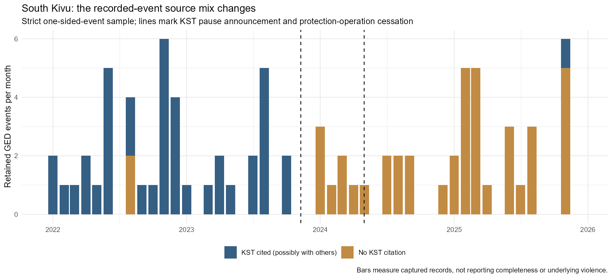

# Reconstructing protection reach and reporting continuity

11 November 2026. Follow-up to the withdrawal feasibility audit; no effect models fitted.

**The public record supports a partial reconstruction of named deployment areas, not defensible protection-area polygons. It also establishes that South Kivu reporting continued, but not that it remained equally complete.** Neither finding clears the causal-design barrier.

## 2017: a change in the form of presence

The [activity ledger](../data/withdrawal_feasibility/protection_area_evidence_2017.csv) separates named places, reported operational dates, planned endpoints, undated captions, and proposed deployments. Its 16 evidence rows are documentary observations, not 16 patrols or independent experiments. [Source details and access limitations](../data/withdrawal_feasibility/coverage_followup_sources.csv) accompany every row.

| Closed site or group | Reconstructed reach / remaining activity | What remains unknown |
|---|---|---|
| Masisi-centre | Mobile deployments at Masisi-centre and Lukweti from early August | Patrol frequency, duration, and communities reached before versus after |
| Nyabiondo | Mobile presence reported from early August; a separate September mission originated at Sake and reached Nyabiondo | Full route and frequency; whether short visits replaced routine protection |
| Walikale-centre and Bunyampuri | Regional mobile deployments at Ntoto, Buleusa and Kabalo | Which communities formerly served by each closed base were actually covered |
| Luofu | Temporary-base caption; short regional deployment at Kahumo near Miriki; later Luofu closure reported in 2019 | Caption date; reopening or conversion history; operational linkage to Luofu |
| Pinga | Kitshanga identified as a nearby retained base, with road-access concerns; later accounts name Kashuga/Kalembe as affected areas | Conflicting closure month and territorial attribution; no verified 2017 response catchment |
| Katale and Munigi | Earlier consolidation plans toward Sake | Verified completed departure and realized replacement patrol coverage |

MONUSCO's 11 August account reports the five fixed bases closed on 31 July and mobile deployments began on 3 August. It names the places in the first three rows. Its Luofu photograph is useful evidence of a temporary base, but the image's date is unspecified. A subsequent weekly briefing describes departing personnel at Nyabiondo; these milestones need reconciliation before assigning a final-convoy day. The broad audit interval is therefore retained rather than narrowed mechanically. [MONUSCO, 11 August](https://monusco.unmissions.org/fr/news/la-monusco-experimente-un-nouveau-dispositif-militaire-au-nord-kivu-apres-la-fermeture) · [9–16 August briefing](https://monusco.unmissions.org/sites/default/files/compte-rendu_de_lactualite_des_nations_unies_en_rdc_du_9_au_16_aout_2017.pdf)

The next weekly briefing supplies bounded deployments: Buleusa, 13–19 August; Kabalo, 14–18 August; Kahumo, 16–17 August. These establish activity on particular dates, not protection between visits. It calls Buleusa part of Lubero, whereas the earlier account places it in Walikale. That inconsistency is retained rather than resolved from the name alone. [16–23 August briefing](https://monusco.unmissions.org/sites/default/files/compte-rendu_de_lactualite_des_nations_unies_en_rdc_du_16_au_23_aout_2017_final.pdf)

The strongest explicit origin–destination link is a 15–16 September mission from Sake to the Nyabiondo area that extracted children from armed groups. This makes Sake evidence of continuing reach into the affected area, not an isolated untreated comparator. No intermediate route has been invented. [13–20 September briefing](https://monusco.unmissions.org/sites/default/files/compte-rendu_de_lactualite_des_nations_unies_en_rdc_du_13_au_20_septembre_final.pdf)

### Corrections to the earlier register

**Pinga is now documentary only.** CIVIC says May 2017; UNJHRO says August and uses Masisi rather than Walikale. The latter also identifies Kashuga/Kalembe as affected areas and describes a proposed longer presence at Nyabiondo in February 2018 that was not realized. We cannot turn either account into a verified catchment or settle the date by choosing the one that fits the outcome series. Pinga's assigned locality and numeric transition interval are now missing; the earlier register is preserved separately. [CIVIC, p. 22](https://civiliansinconflict.org/wp-content/uploads/2018/02/Protection-Mandate-French-Translation-Web.pdf) · [UNJHRO, paragraph 87](https://monusco.unmissions.org/sites/default/files/bcnudh_rapport_masisi-lubero_19_decembre_2018_-_final_1.pdf)

**Luofu cannot be coded as continuously absent from 2017.** A later UNJHRO report dates another closure to June 2019, followed by Kirumba six months later. Whether these represent reopening, temporary-base conversion, or differing descriptions must be resolved. These are documentary leads, not additional fitted experiments. [UNJHRO 2019–2021 review, paragraphs 17–18](https://monusco.unmissions.org/sites/default/files/bcnudh_rapport_sur_la_protection_des_civils_masisi_et_lubero_janvier_2019_a_juin_2021.pdf)

There is no source-supported fixed radius around these bases, complete patrol schedule, or measured change in response time. Earlier regional operations and later visits cannot fill those gaps. The defensible description is **reduced fixed presence with selective mobile protection**; neither total territorial withdrawal nor unchanged protection is established.

## South Kivu: reporting activity survived, comparability remains unresolved

Three distinct systems must be kept separate:

1. **Kivu Security Tracker:** its partners announced a collection pause on 9 November 2023. The source mix changes before the April 2024 withdrawal, so that change cannot simply be attributed to withdrawal. The announcement does not quantify missed events or establish the restart date. [CRG statement](https://www.congoresearchgroup.org/en/2023/11/09/dr-congo-system-vulnerability-of-the-kivu-security-tracker/)
2. **MONUSCO security-incident reporting:** the June report cuts off its South Kivu series at 30 April because of withdrawal. This applies to that series; it does not establish that every UN or humanitarian monitoring activity stopped. [S/2024/482, paragraph 19](https://documents.un.org/api/symbol/access?l=en&s=s%2F2024%2F482&t=pdf)
3. **Humanitarian monitoring and local news:** Protection Cluster reports continue to describe Kalehe, Fizi and Uvira after withdrawal. GED also retains post-withdrawal records citing Radio Okapi, La Prunelle, Kivu Morning Post and other outlets. Existence of reports does not establish stable detection of every eligible incident.

April, January–June, and August humanitarian reporting all identify Kalehe, Fizi and Uvira. The latter two explicitly warn about limited monitoring coverage. The August table records 367 broad violations/abuses across those three territories, **not 367 deaths or UCDP events**. No comparable complete mortality series is established for the remaining five study territories by these tables. Their absence from a table is unknown coverage, not zero violence. [April report](https://globalprotectioncluster.org/sites/default/files/2024-05/points_saillants_situation_de_protection_rdc_avril_2024_240523_.pdf) · [First-half report](https://globalprotectioncluster.org/sites/default/files/2024-08/points_saillants_situation_de_protection_en_rdc_apercu_semestriel_janvier-juin_2024.pdf) · [August report](https://globalprotectioncluster.org/sites/default/files/2024-09/points_saillants_situation_de_protection_en_rd_congo_aout_2024_vf_3.pdf)

The UN also announced a residual civilian team to support alert networks and other functions from July. That is evidence against equating military departure with the announced end of all information channels; it does not certify that the team maintained the former observation footprint. [UN transition statement](https://peacekeeping.un.org/en/press-releases/monusco-ending-its-mission-in-south-kivu-after-more-than-20-years-of)

The April humanitarian narrative dates departure from the Bunyakiri/Kalonge area to 18 April, whereas the existing formal Bunyakiri handover date is 19 April. Both are retained as distinct claims; existing handover counts were not silently re-anchored.

### Reproducible citation check

The new R audit uses the same fixed geography, GED version and outcome rules. These are strict-sample **captured records**, with source shares computed among those records:

| Period | Retained events | Recorded civilian deaths | Events citing KST |
|---|---:|---:|---:|
| 2022 | 28 | 66 | 26 |
| January–October 2023 | 14 | 13 | 14 |
| November–December 2023 | 0 | 0 | 0; share undefined |
| January–March 2024 | 6 | 5 | 0 |
| April 2024 | 1 | 1 | 0 |
| May–October 2024 | 7 | 8 | 0 |
| November–December 2024 | 1 | 1 | 0 |
| 2025 | 26 | 100 | 1 |

Relaxing spatial precision does not restore KST citations in 2024: the conservative territorial series has 19 events and 18 civilian deaths, while the broader spatial-precision screen has 23 events and 29 deaths; both have zero KST citations. The broader screen is a diagnostic, not an approved replacement outcome. Changing location filters and changing reporting sources are separate issues. A 2025 KST citation does not by itself date resumed collection.

The broader screen also contains one November–December 2023 event with five civilian deaths, despite the strict sample's zero. The strict zero therefore cannot be described as a complete reporting blackout.

Three event-level checks also distinguish a missing report from an uncertain death estimate. GED 538744 and 565242 are present with best/civilian counts of zero and upper estimates of one. GED 524907 has best/civilian deaths of one and an upper estimate of seven. Their headlines cannot simply replace the stored estimates. The records and bounds are saved; these checks are not an exhaustive reconciliation of fatality uncertainty.

ACLED's historical KST integration is another reason an eventual cross-dataset check must inspect sources: two datasets can reuse the same reporting network. Agreement would not automatically constitute independent confirmation. [ACLED provider update](https://acleddata.com/update-log/data-update-integration-data-kivu-security-tracker-acleds-democratic-republic-congo)

## What this changes for the study

The register now has 21 descriptive entries and 15 documentary-only entries; none is upgraded to a causal candidate. The next evidence request should be for **base operating histories and dated patrol/task logs** for the Masisi–Nyabiondo–Sake network, and **monitor locations, operating periods and incident lists** for matched South Kivu areas. The former is a concrete network with repeated documented activity; it still lacks a stable untreated comparison. The latter could distinguish changing detection from changing violence, but public aggregate tables cannot supply a missing-event correction factor.

Until those records are available, retain a documentary/descriptive study of operational change and observed violence. Do not draw arbitrary catchment buffers, assume that mobile patrols fully replaced fixed bases, turn unlisted areas into reporting zeros, or interpret the South Kivu mortality decline as a withdrawal effect.

## Files and validation

### Public records follow-up and data requests

Checked 11 November 2026. **A working public UNHCR coverage dashboard exists, but the inspected view does not establish historical coverage around the handovers.** The [SAR portal](https://sar-drc.unhcr.org/) links to a Power BI coverage map. Browser inspection showed 205 monitors and 34,615 data forms, with no visible reporting period or historical coverage controls. These are undated dashboard totals, not South Kivu observations or estimates of 2024 monitoring effort. The linked [data page](https://sar-drc-test.unhcr.org/?page_id=758) labels its recent data August 2021 and exposes no populated monthly table in the retrieved text. Its test-domain link and old label require provenance checks; neither proves the underlying records end in 2021.

The portal publicly lists contact@sarmp.unhcr.org. The current [DRC Protection Cluster directory](https://globalprotectioncluster.org/democratic-republic-congo) identifies Steve Ndikumwenayo as coordinator and Eric Bazie as information management officer. These are routing leads; no response, historical export, or confirmation of access has been obtained. A listed contact is not verification that the mailbox remains staffed. The directory's separate dashboard link is labelled South Sudan Protection Risk and should not be assumed to contain DRC coverage data.

The [2024 annual report, page 4](https://globalprotectioncluster.org/sites/default/files/2025-03/rapport_annuel_du_cluster_protection_rd_congo_annee_2024.pdf) reports reduced logistical support, humanitarian access and capacity to monitor atrocities following the South Kivu withdrawal. This strengthens the evidence for changing observation conditions. It does not identify a UCDP undercount, provide a correction factor, or establish the month and locality of every interruption. The report also advertises a monitoring-partner coverage tool; availability of its archived monthly inputs remains unverified. The [31 December operational-presence snapshot](https://globalprotectioncluster.org/sites/default/files/2025-02/presence_operationnelle_cluster_protection_rdc_31122024.pdf) can identify partners and activities, but service presence is not equivalent to continuous incident surveillance.

For patrols, the public [OIOS audit 2017/011](https://oios.un.org/file/6545/download?token=aJ2sFKHb) refers to patrol data and discrepancies between planned and completed activities. The underlying dated operational dataset has not been located publicly. Direct access was intermittent; the indexed audit supports the existence of records, not their release or completeness for the July 2017 closures. [UN Archives](https://archives.un.org/en/content/about-us) lists arms@un.org as a research contact. It is a suitable starting point for identifying the record custodian and access process, not a confirmed holder of the requested MONUSCO files. Request referral to the mission/DPO if the records have not been transferred.

**Two bounded inquiries are ready in [the request specifications](withdrawal_records_request_specifications.txt). Neither has been sent.** First establish whether historical, releasable records and their completeness metadata exist; ask for a small sample and dictionary before requesting a large export.

| Inquiry | Initial scope | Minimum useful result | Decision if unavailable |
|---|---|---|---|
| Executed patrols and base operating histories | Masisi-centre, Nyabiondo and Sake; July 2015 through February 2018 | Dated completed visits, origin and destination, base operating intervals, and explicit completeness limits | Keep operational change documentary/descriptive; do not code closed bases as no protection |
| Incident-monitoring coverage | South Kivu, April 2022 through November 2024; all eight study territories, including areas around Bunyakiri, Kavumu and Sange | Location-month coverage status, activity/interruptions, zero-reporting rules and collection-method changes | Do not interpret recorded mortality changes as changes in underlying mortality |

The patrol window includes baseline and follow-up around July 2017; it is a retrieval envelope, not a new treatment-date decision. The monitoring window includes complete months spanning the existing 24-month baselines and six-month follow-ups. Counts of staff or beneficiaries alone do not meet the monitoring requirement. If more granular data are withheld, aggregated location-month coverage and completed-patrol summaries would still be useful. Missing records remain unknown, never zero. Any eventual use of retained Sake presence must address its documented operations into Nyabiondo.

The next decision is conditional on the custodian response: (1) usable historical metadata permits a matched coverage audit; (2) only isolated summaries supports the existing descriptive study; (3) inaccessible or unavailable records closes this acquisition route. Even complete records would not independently resolve withdrawal selection, concurrent shocks or spillovers. No new causal candidate is declared and no statistical model is fitted.

Run `Rscript scripts/update_withdrawal_coverage_evidence.R`, then `Rscript scripts/audit_withdrawal_feasibility.R`, then `Rscript scripts/audit_south_kivu_reporting_continuity.R`. The first script applies the documented corrections idempotently and preserves the earlier register; the others rebuild outputs without fitting models.

The original 608 locality-quarter outcomes and 12 handover windows still reproduce. The follow-up reconciles all eight province-year/definition totals with the prior audit, preserves missing source shares for zero-event months, and saves all eight localities' reporting checkpoints. Inputs are hashed. The source ledger distinguishes indexed extracts from full text; not every original PDF was downloadable. No complete patrol map or complete incident-reporting census is claimed.
