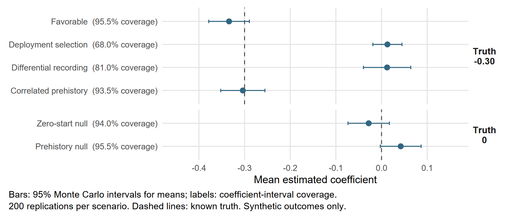
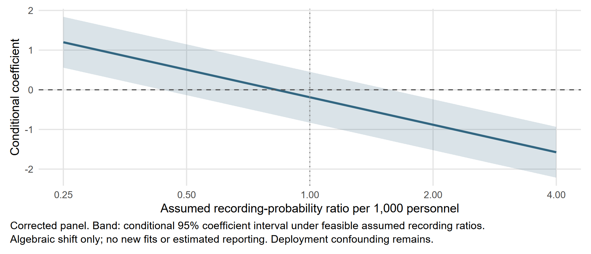

# Protection or apparent protection around MONUSCO

## Local violence and observation uncertainty in a quarterly pilot

Prepared for Marc A. Scott | Updated 7 November 2026

**The corrected panel still does not establish a protective or harmful deployment association.** Source corrections make the estimate somewhat more negative, with wide uncertainty. The original analysis modestly improved retrospective prediction, but that gain was concentrated geographically and prediction has not been rerun on the corrected panel. The contribution is a reproducible methodological application that examines recovery and measurement uncertainty, rather than a new identification result.

## Scope and measurement

The original question concerned variation across localities in the association between peacekeeping presence and subsequent recorded violence. The audit narrowed that ambition. The active study covers 2016-2023 in Nord-Kivu, Sud-Kivu and Ituri, using 19 fixed city-territory composites. Nine have complete eligible deployment histories, yielding 288 locality-quarters and 1,248 retained one-sided violence events. Their selection is based on full-period exposure availability and limits generalization.

The primary outcome counts UCDP GED 26.1 events with exact-place coding, a unique geographic assignment and dates contained in one month. UCDP's qualifying lethal organized violence is not a measure of all civilian harm. Recorded civilian fatalities in the same events form a separate outcome. The workflow preserves source versions, hashes, exclusions and geographic crosswalks; original and row-level derived files remain separate from published summaries. [1, 3]

Geo-PKO 2.3 supplies listed military strength, excluding formed police units, rather than a verified presence-versus-absence contrast. Monthly rows carry source-map information forward. The exposure is the previous quarter's mean listed strength per 1,000 personnel, requiring three usable months and map ages no greater than five months. Unlisted deployment remains unknown. A three-month rule leaves no uninterrupted locality series, although an unbalanced analysis is possible. Quarterly aggregation reduces temporal detail without resolving uncertainty about when deployments changed. [2]

## Model and estimand

The negative-binomial model includes a locality random intercept, province effects, a linear quarterly trend and seasonality. It separates within-locality deviations in lagged strength from between-locality mean strength, then adjusts for the log-transformed previous recorded event count, prior violent-spell duration and an earlier strength lag. The target is a common conditional within-locality association per 1,000 personnel.

Locality-specific deployment slopes were not fitted. The original design had within-strength variation in eight localities and adjacent within-strength lag correlation of 0.954; heterogeneity remains outside this common-slope pilot. The corrected coefficient is -0.189 (conditional 95% Wald interval [-0.830, 0.452]), giving a count ratio of **0.828 [0.436, 1.572]**. Both directions remain compatible with the interval. Correcting source coding does not establish causal identification or remove nine-locality uncertainty.

<!-- pagebreak -->

## What simulation establishes

Simulation preceded the original empirical fitting and has not been rerun on the corrected exposure schedule. An initial fixed-design experiment used 800 fits. The dynamic evaluation used the original nine-locality schedule, synthetic counts, known coefficients and explicit initial histories; responsive selection perturbed that schedule. It retained 1,400 fits across 1,200 generated panels; two estimators shared 200 prehistory panels. Favorable, null, correlated-prehistory, responsive-deployment and differential-recording scenarios each used 200 replications.

*Figure 1. Synthetic recovery on the original exposure design. Mean estimates and Monte Carlo intervals summarize repeated simulations, not empirical locality effects or individual coefficient intervals. Coverage refers to nominal 95% coefficient intervals. The known nonnull coefficient is -0.30; this exercise was not repeated for the corrected panel.*

The ordinary model passed its prespecified favorable and initial-condition screens. Coverage was 95.5% in the favorable scenario and 93.5% with correlated prehistory. The matched prehistory null gave 95.5% coverage and a 4.5% false-direction rate. Its bias of 0.042, with Monte Carlo SE 0.023, was close to the 0.05 tolerance. Passing this finite screen does not establish negligible bias more generally.

The adverse scenarios were informative failures. Deployment responding to past violence and hidden risk produced bias of +0.313 and coverage of 68%; differential recording produced bias of +0.312 and coverage of 81%. Successful numerical estimation therefore coexisted with poor recovery of the known coefficient. Even favorable RMSE was about 0.32, comparable to the magnitude of the simulated effect. The design offers limited precision.

The simulation is illustrative rather than calibrated to every empirical parameter. Its correlated prehistory comes from a finite 40-quarter run, not a proof of stationarity. An initial-condition adjustment was diagnostic only and could not be transferred unchanged to the empirical design because its columns were redundant. No new theorem, latent-state identification, or recoverable local slope distribution is claimed.

<!-- pagebreak -->

## Corrected panel and observation sensitivity

The corrected sensitivity supplement propagates Nyamilima's locality reassignment, adjudicated Rwindi/Nyamilima unit assignments and Bukavu's military-only subtotal. Mavivi uses a sized military total of 2,200, not verified headcount; the provider's field discrepancy remains unexplained. A 2,350 alternative applies only to map revision 51. Outcomes, sample membership and model specification are unchanged. Original sources and the primary analysis are preserved. [7]

| Exposure version | Coefficient | Conditional 95% interval |
|---|---:|---:|
| Original reference | -0.133 | [-0.770, 0.504] |
| Supported corrections | -0.189 | [-0.830, 0.452] |
| Corrections plus Mavivi alternative | -0.210 | [-0.850, 0.429] |

*Figure 2. Corrected-panel association under assumed recording differences. The band is conditional on each recording ratio; movement along the curve changes the assumption. This is an algebraic shift of the corrected coefficient, not an estimated recording process or a new model fit.*

The corrected point estimate changes sign at an assumed recording-probability ratio of 0.828 per additional 1,000 personnel. The conditional interval is wholly positive below 0.436 or wholly negative above 1.572. Equal recording leaves an inconclusive result. These are hypothetical log-linear assumptions; nonlinear mechanisms yield other thresholds. Reporting sensitivity does not remove deployment confounding.

All 13 follow-up fits were usable and independently reproduced in the retained isolated environment. All nine corrected-panel locality-deletion intervals include zero. Corrected Pearson lag-two residual correlation remains 0.187, compared with 0.189 originally. This warns of unresolved temporal structure; it is not a calibrated significance test. The earlier timing, outcome, year-deletion and simulation checks were not repeated on this panel. The small coefficient shift is descriptive, not an equivalence test.

<!-- pagebreak -->

## Prediction and discussion

The original-panel rolling evaluation predicted 2019 Q1 through 2023 Q4 with training-only exposure means and preceding-quarter outcomes. All 40 fits were usable, producing 180 forecasts per model. Mean log score improved by 0.0429, with improvement in 14 of 20 quarters but only four of nine locality averages. Excluding Irumu's scores reversed the aggregate advantage without refitting. These results have not been rerun on the corrected panel.

| Held-out metric | Baseline | History |
|---|---:|---:|
| Mean log score | -2.2296 | -2.1867 |
| Mean absolute count error | 5.004 | 3.805 |
| Observed coverage of 95% intervals | 95.0% | 95.0% |
| Mean 95% interval width | 22.98 | 17.07 |

The intervals are conditional plug-in NB2 predictions, omitting parameter and locality-effect uncertainty. Localities were selected retrospectively. Subsequent work located archived releases, but complete September coded inputs and deployment histories available by 1 October 2023 remain uncertified. Occurrence dates alone do not establish availability. These are retrospective predictions of recorded violence, not validated operational forecasts or latent violence. [7]

This application connects to your work on prediction and uncertainty conditional on sequence history, the IES project's concern with heterogeneity and overstated certainty, and thinkCausal's attention to methods as implemented in practice. [4-6] It does not implement the sequence paper's decomposition or evaluate software usability. The repository makes the underlying work inspectable: source reconciliation, multilevel estimation, simulation with known truth, and tests of assumptions and uncertainty.

I would next compare the current model with one prespecified second violence-history lag, retaining the same measurement rules and evaluating both models in matched simulation and rolling prediction. The comparison should be judged by recovery and prediction before examining whether the deployment coefficient becomes more favorable. Two questions would help bound that extension:

1. With residual lag-two structure and nine localities, would a second violence-history lag be informative, or would it mainly add instability?
2. What simulation evidence and deployment variation would justify reintroducing locality-specific deployment slopes?

Better deployment-change dates, listing-completeness evidence and historical publication records would reduce uncertainty that richer regression cannot resolve. Human review was skipped at the user's request and remains incomplete. The findings support methodological discussion without locality rankings or deployment recommendations.

### Sources and reproducibility

[1] [UCDP methodology and GED](https://www.uu.se/en/department/peace-and-conflict-research/research/ucdp/ucdp-methodology.html), GED 26.1. [2] [Geo-PKO dataset](https://www.uu.se/en/department/peace-and-conflict-research/research/research-data/geo-pko-dataset), version 2.3. [3] [Repository findings and reproducible evidence](https://github.com/LystadJS/UN-Peacekeeping/blob/36f4b09adcddb954db3de59975155fc95659f513/docs/quarterly_evaluation_findings.md).

[4] Scott, Pennoni and Bórquez (2026), [Knowing What We Don't Know](https://doi.org/10.3390/e28070730). [5] NYU, [IES project on heterogeneity and uncertainty](https://steinhardt.nyu.edu/priism/what-when-and-whom). [6] Perrett, Hill, Srivastava and Scott (2026), [thinkCausal software evaluation](https://doi.org/10.1080/00031305.2026.2627264).

[7] [Corrected-panel findings and reproduction evidence](https://github.com/LystadJS/UN-Peacekeeping/blob/8510728538026e8e3da1910360c0671b96dd0c2c/docs/corrected_panel_sensitivity_findings.md), 7 November 2026. Original simulation and predictive results above retain their original-panel scope.
